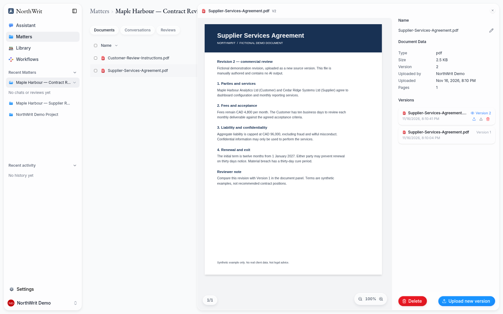
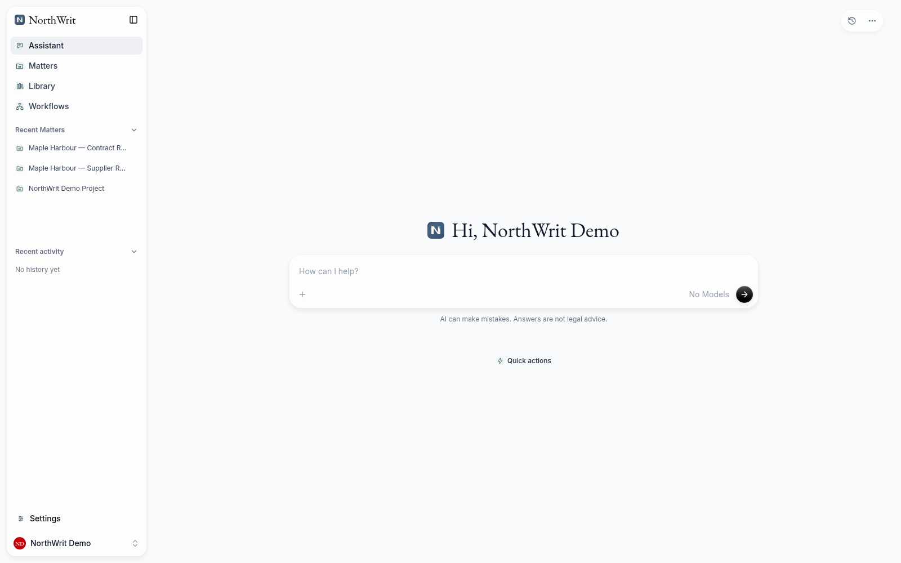
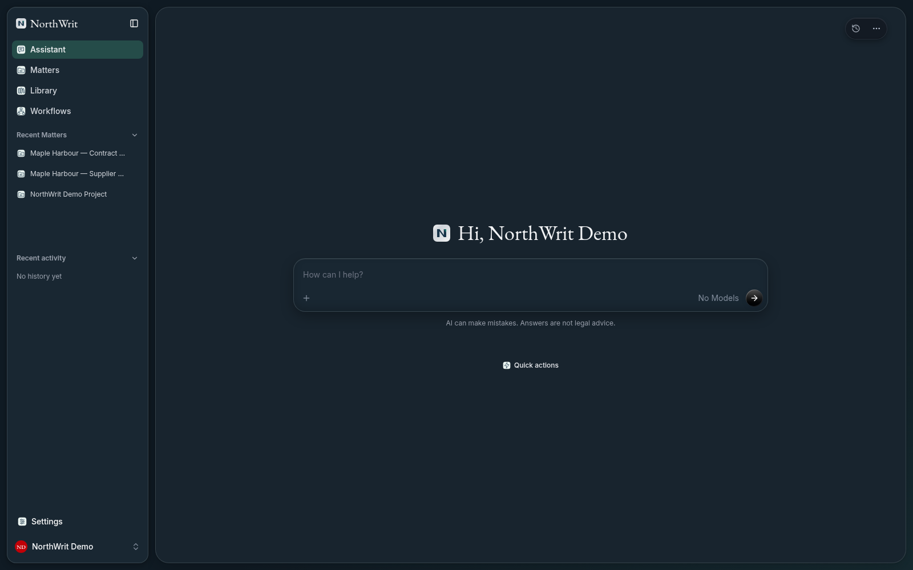
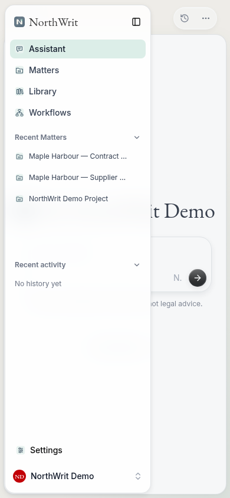
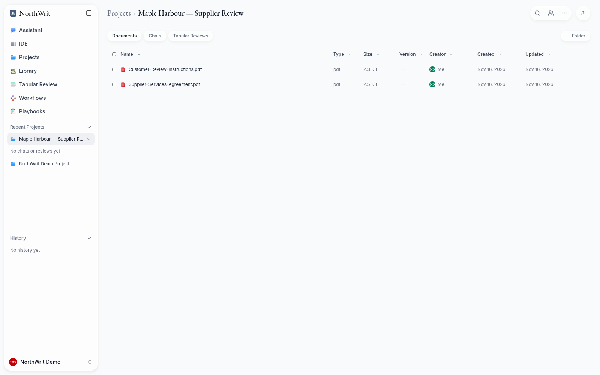
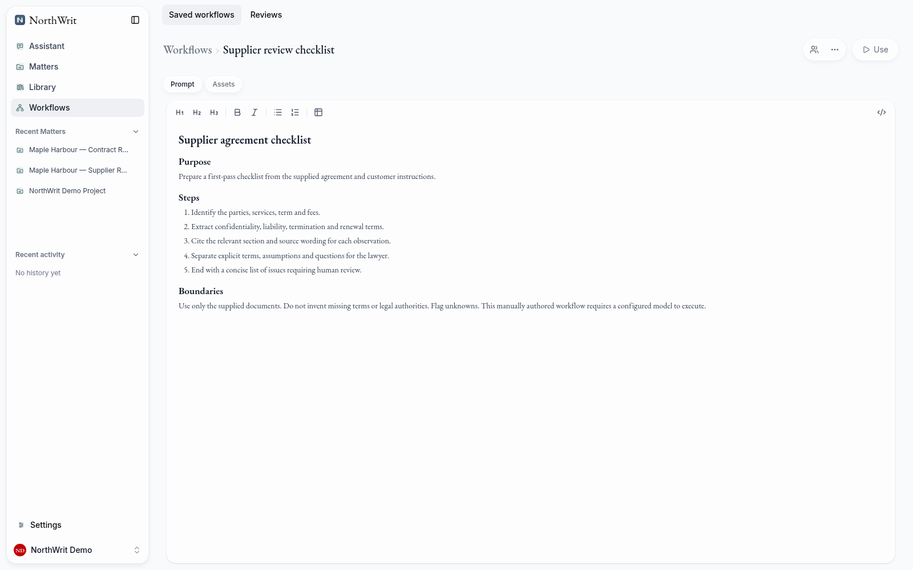
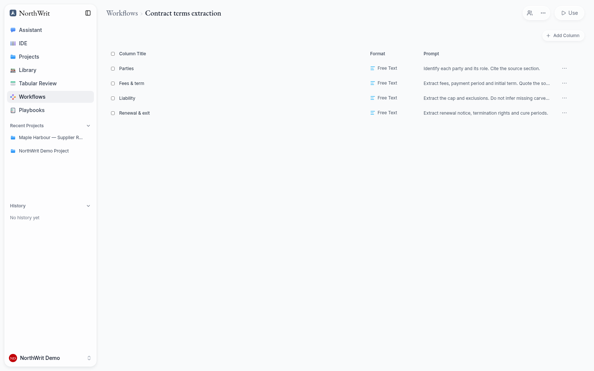
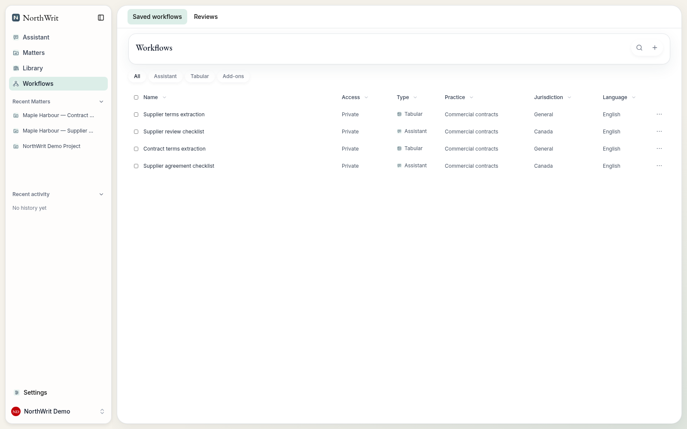
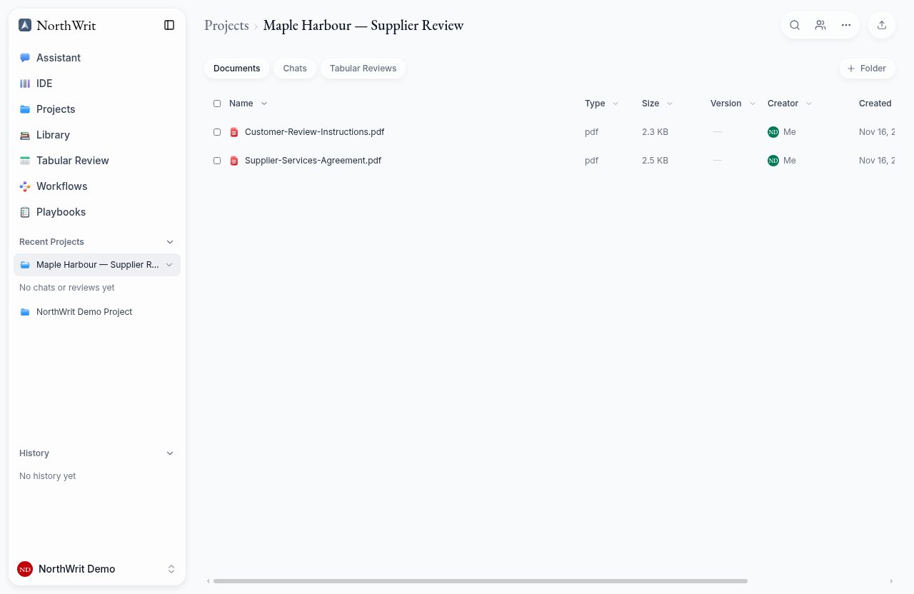

# NorthWrit


### Your documents. Your review process. One focused workspace.

NorthWrit brings matter files, source previews and reusable review workflows together for legal teams. Organize a client matter, keep document versions accessible, and prepare consistent review instructions from the web or desktop client.

Built for Canadian law firms and in-house teams. **Available as a development preview.**

[Explore the product](docs/02-product/NorthWrit-Product-Catalogue.md) · [Walk through the demo](docs/guides/demo.md) · [Run locally](#install-and-run) · [See the roadmap](docs/07-implementation/NorthWrit-Implementation-Plan.md)



*Open the source document alongside its matter context, metadata and available versions. All screenshots use fictional documents and a synthetic account.*

## Four places to focus

**Assistant** for document conversations · **Matters** for client work · **Library** for files, templates and playbooks · **Workflows** for reusable instructions and reviews.



*Start a conversation with authorized documents and an available model. This capture shows the Assistant starting screen, before AI execution.*

## A calmer workspace

Floating glass navigation and controls frame solid reading surfaces for documents, conversations and review tables. Light and dark themes, compact mobile navigation, and opaque accessibility fallbacks keep the focus on your work.

<details>
<summary>See dark mode and mobile navigation</summary>





</details>

See the [UI walkthrough and verification](docs/07-implementation/NorthWrit-Floating-Glass-Plan.md) for real web and Electron captures.

## Built around the work

| What you need | How NorthWrit helps |
|---|---|
| Keep a review organized | Group source documents and related work in Matters. |
| Read the actual source | Preview PDFs in the workspace and inspect document metadata and versions. |
| Make your process repeatable | Save Assistant instructions and tabular extraction questions as reusable workflows. |
| Prepare a structured review | Define columns for parties, commercial terms, liability, renewal and other questions. |
| Work across clients | Access the same matter from the web app and Electron desktop client. |
| Add AI when ready | Connect a supported model to use AI chat, extraction and drafting capabilities described in the [product catalogue](docs/02-product/NorthWrit-Product-Catalogue.md). |

## Follow a supplier-review demo

A fictional customer, Maple Harbour Analytics, is reviewing a supplier services agreement. The demo takes the source files through a real local application journey:

1. Create the **Maple Harbour — Contract Review** matter.
2. Upload the agreement and customer instructions; wait for document processing.
3. Open the agreement, upload a revised source and inspect both versions.
4. Save a **Supplier review checklist** Assistant workflow.
5. Define a **Supplier terms extraction** tabular workflow.
6. Open the same matter in the desktop client.

These screens were captured from the running application. Matter creation, uploads, processing, source preview, version creation/download, workflow configuration and cross-client access were verified. **AI execution was not run:** the screenshots show saved instructions and review setup, with no generated answers or findings. A configured model is required to run those AI actions.

### Keep source material together



*The matter holds the agreement and the customer's instructions in one document list.*

### Turn a checklist into a reusable workflow



*Define the steps, source-citation instructions and questions for the reviewer. This workflow is saved and ready for execution once a model is configured.*

### Define the questions before running a review



*Prepare a consistent extraction structure. This is configuration, not an AI-completed review table.*

<details>
<summary>See the workflow library and desktop client</summary>



*Both reusable workflows are saved in the demo account.*



*The actual Electron client connected to the same local application. Captured on Linux; macOS packaging and signing are separate checks.*

</details>

The [demo guide](docs/guides/demo.md) includes sample PDFs, workflow instructions, capture details and the verified scope.

## Explore NorthWrit

- **Users:** [Product catalogue](docs/02-product/NorthWrit-Product-Catalogue.md) · [User guide](docs/guides/user-guide.md) · [Demo walkthrough](docs/guides/demo.md)
- **Administrators:** [Local development](docs/engineering/local-development.md) · [Administrator guide](docs/guides/administrator.md) · [Security overview](docs/guides/security.md)
- **Developers:** [Developer guide](docs/guides/developer.md) · [Current architecture](docs/06-technical/NorthWrit-Current-Implementation.md) · [System flows](docs/06-technical/NorthWrit-System-Flows.md)
- **Product planning:** [105-feature capability matrix](docs/04-specs/NorthWrit-Capability-Matrix.md) · [Implementation plan](docs/07-implementation/NorthWrit-Implementation-Plan.md) · [Documentation index](docs/README.md)

## Current scope

The current application includes Matters, document processing, Assistant, Tabular Reviews, workflows, playbooks and client integrations. Availability depends on configuration and permissions. The full legal matter model, Canadian research, Bearings, four-state CiteCheck, Shield policies and version-bound Folio approvals remain planned work. Pilot acceptance, residency and security guarantees require their own evidence; see the [current capability reference](docs/06-technical/NorthWrit-Current-Implementation.md).

<details>
<summary>Develop and self-host NorthWrit</summary>

## Repository layout

The expanded layout is merged. Migration checks and remaining limits are recorded in the [migration verification](docs/07-implementation/NorthWrit-Migration-Verification.md).

```text
package.json             Nine private npm workspaces and root commands
package-lock.json        Shared frozen dependency graph
.npmrc                   Nested app installs with shared root peers
apps/
  web/                   Next.js web portal
  api/                   API, domain services, database schema and jobs
  worker/                Standalone launcher using the API worker runtime
  word-addin/            Microsoft Word integration
  desktop/               Electron shell
packages/
  contracts/             Shared serialized API contracts
  client/                Framework-free client behaviour
  ui/                    Shared interface components
  byok-validation/       Shared test fixtures; not an npm workspace
  pdf-text-order/        Shared test fixtures; not an npm workspace
infra/                   Compose, Docker support and Supabase gateway
  docker-compose.yml
tests/browser/           Existing Playwright package and tests
tests/loadtest/          Performance tooling
docs/engineering/        Application engineering and operating guides
scripts/application/     Shared application maintenance tools
docs/                    Product requirements, decisions and delivery evidence
.github/workflows/       Active application and container-build CI
```

## Install and run

Use Node.js 22 or later and npm (the lockfile was generated with npm 11.9.0). The root manifest defines nine private npm workspaces, with one root `package-lock.json`. See [ADR 0003](docs/decisions/0003-npm-root-workspace.md). Package identities and shared imports use `@northwrit/*`; upstream credits and compatibility-sensitive identifiers retain their provenance.

Run commands from the repository root:

```bash
npm run check:repo
npm run setup
```

`setup` runs one frozen `npm ci` for all workspaces, including desktop and browser tooling. Targeted installs use `npm run setup:api`, `setup:web`, `setup:word`, `setup:worker`, `setup:desktop` or `setup:e2e`, all from the same root lock. A targeted `npm ci` replaces the installation tree, so install all required workspaces together with `npm ci --workspace apps/api --workspace apps/web`, or use full `setup`. Do not generate child lockfiles. Electron downloads require access to GitHub release assets. Installation does not start infrastructure or services.

When switching an existing checkout from independent installs, delete the generated `apps/web/tsconfig.tsbuildinfo` cache once if TypeScript retains old dependency-resolution errors. Fresh checkouts do not have this cache.

Follow [application local development](docs/engineering/local-development.md) to configure the database, auth, storage, local email and separate signing/encryption secrets. Keep email confirmation enabled. Use synthetic documents and disposable accounts for validation. The [safe testing guide](docs/engineering/safe-local-testing.md) describes these boundaries.

For a fresh local stack, copy `infra/.env.example` to `infra/.env` and `apps/api/.env.example` to `apps/api/.env`, then follow the local development guide. Preserve existing `.env` files when updating a checkout. Run `npm run infra:prepare` to make the three public bind-mounted configuration files readable, then start it from the repository root with `docker compose -f infra/docker-compose.yml up --build`. The `stack:up` helper performs an automatic cleanup sweep by default; read the [lifecycle and cleanup behaviour](docs/engineering/local-development.md#stop-and-clean-up) before using it. Starting Compose does not publish images.

With the required infrastructure configured, start each process in its own terminal:

```bash
npm run dev:api
npm run dev:web
```

For a separate worker process, run `npm run build:worker` and `npm run start:worker`, and set `WORKERS_MODE=none` on the API. See [worker instructions](apps/worker/README.md).

The commands above are separate terminal commands. They do not start the full Compose stack. `npm run dev:word` serves the Word development client; use the [Word guide](apps/word-addin/README.md) for HTTPS and sideloading requirements. A cloud process listening on localhost is not automatically reachable from your own computer; interactive testing needs a working cloud Desktop, platform forwarding or a local deployment.

## Verify changes

| Command | Scope |
|---|---|
| `npm run check:repo` | Repository entry points, package commands, local links and CI paths; no dependencies or services required |
| `npm run check:branding` | Active naming, exact reviewed compatibility references and frozen historical snapshots |
| `npm run check:whitespace` | Git whitespace validation for tracked changes; does not format source |
| `npm run test:api -- --maxWorkers=2` | Backend unit and route integration tests |
| `npm run test:web -- --maxWorkers=2` | Web/shared component and hook tests |
| `npm run test:word` | Word HTTP host tests |
| `npm run typecheck` | API, API test types, contracts, web and Word types |
| `npm run lint` | Existing web ESLint rules |
| `npm run build` | API, web and Word production builds; Word build URLs must be configured |

Use `:api`, `:web` or `:word` commands to run checks for one package. `typecheck:api` passes `--noEmit` to the existing API compiler script. For package-specific run/test commands, arguments after `--` reach the underlying command, and its exit status is preserved. `test` and `build` run packages sequentially and stop on failure. Use existing package lint/style conventions; this setup adds no formatter dependency.

For a local Word build check, set the build URLs in the shell running the command. These reserved addresses validate a build and do not deploy anything:

```bash
# Bash
WORD_ADDIN_PUBLIC_URL=https://northwrit.invalid REACT_APP_WEB_APP_URL=https://app.northwrit.invalid npm run build:word
```

```powershell
# PowerShell
$env:WORD_ADDIN_PUBLIC_URL = 'https://northwrit.invalid'
$env:REACT_APP_WEB_APP_URL = 'https://app.northwrit.invalid'
npm run build:word
```

Use real deployment URLs when producing a release. Use the [observability guide](docs/engineering/observability.md) for current telemetry configuration. Reporting requires an explicitly configured destination; the [configuration record](docs/07-implementation/NorthWrit-Configuration-Verification.md) explains namespace and compatibility rules.

Browser and database suites require additional services. Read the [E2E guide](docs/engineering/e2e-ci.md) before `npm run setup:e2e` and `npm run test:e2e`. They are not part of `npm test`. Do not restart the archived standalone cloud baseline test as part of repository organization.

See the [workspace verification record](docs/07-implementation/NorthWrit-Workspace-Verification.md) for workspace checks and limits; earlier repository and layout records remain historical.

## Delivery phases

| Phase | Status |
|---|---|
| 1 — Source audit | Complete |
| 2 — Product and Architecture Foundation | Restored; foundation evidence available, remaining decisions/review pending |
| 3 — Application integration | Complete; repository layout and npm workspace also merged |
| 4 — Legal workspace | In progress locally: Matter metadata and Overview/settings subsets; full journey and reviewer acceptance pending |
| 5 — Canadian legal capabilities and governance | Planned |
| 6 — Governed integrations | Planned |
| 7 — Validation and pilot release | Planned |

Phase 2 is restored to consolidate product and architecture decisions; completed integration work is preserved. P0/P1/P2 in the product specifications are priority tiers, not these implementation phases. Read the [implementation plan](docs/07-implementation/NorthWrit-Implementation-Plan.md) for scope and acceptance gates.


</details>

## Documentation and licensing

The [documentation index](docs/README.md) separates product requirements from implementation evidence. The current implementation plan and accepted [repository decision](docs/decisions/0002-expanded-repository-structure.md) govern the layout; older blueprints are historical proposals.

Preserve the [license](LICENSE), [notice](NOTICE.md), application [credits](Credit.md) and upstream provenance when changing or distributing the application. Do not commit credentials, local environment files, generated outputs or test documents containing real client information.
