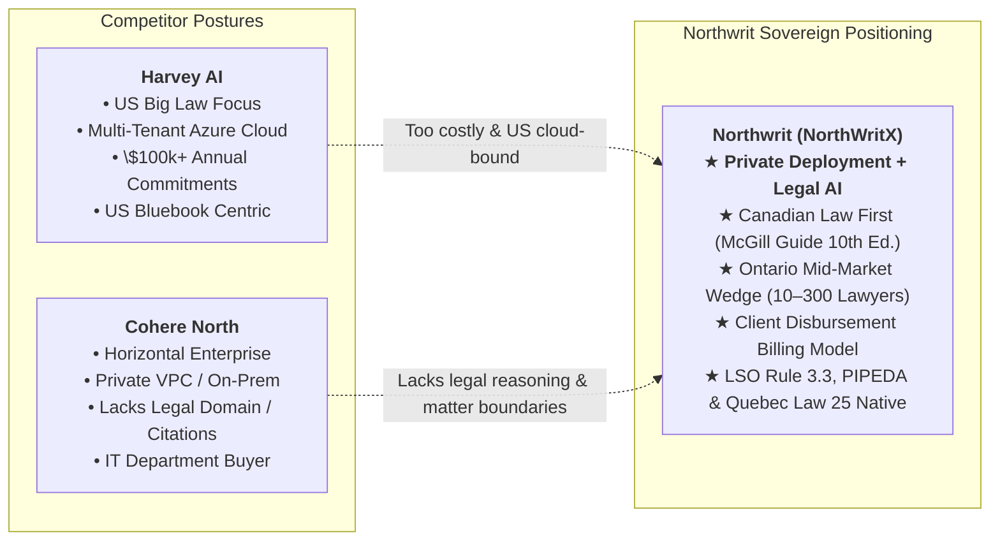

# Northwrit Marketing Site & Go-To-Market (GTM) Strategy
## Commercialization, Pricing, and Sovereign Distribution for Canadian Legal Practice

**Status:** Approved Commercial Specification | **Version:** 2.0 | **Date:** November 5, 2026  
**Document Code:** `NW-MKT-GTM-STRATEGY-01`  
**Cross-References:** [Competitive Analysis](Northwrit_Competitive-Analysis.md) | [Brand Identity](../01-brand/Northwrit_Brand-Identity.md) | [Platform Layers & Surfaces](../06-technical/Northwrit_Platform-Layers-and-Surfaces.md) | [Security & Compliance](../06-technical/Northwrit_Security-Compliance.md)

---

## 1. Executive Summary & Market Positioning



### The Canadian Legal Market Opportunity
* **Total Addressable Market (TAM):** ~3,500 Canadian law firms and corporate legal departments, representing over 45,000 practising lawyers (predominantly in Ontario, Quebec, British Columbia, and Alberta).
* **Serviceable Addressable Market (SAM):** ~850 mid-sized law firms (10–300 lawyers) and enterprise in-house counsel whose clients forbid public/unredacted cloud AI due to strict solicitor-client privilege, Law Society of Ontario (LSO) Rule 3.3, PIPEDA, and Quebec Law 25.
* **The Strategic Wedge:** Harvey AI is too expensive and cloud-captive for Canadian mid-market firms; Thomson Reuters CoCounsel is expensive and locked into the Westlaw walled garden; generic LLMs violate client confidentiality rules. Northwrit wins by offering **private, sovereign deployment with native Canadian legal domain intelligence**.

---

## 2. Marketing Site Architecture (`apps/marketing` / Web)

The public marketing site establishes institutional trust, provides interactive proof of legal rigour, and drives qualified inbound pilot requests from firm managing partners and legal ops directors.

```text
┌────────────────────────────────────────────────────────────────────────────────────────┐
│                              MARKETING SITE SITE MAP                                   │
├────────────────────────────────────────────────────────────────────────────────────────┤
│  1. HOME (HERO & SOVEREIGN PROOF)                                                      │
│  • Value Proposition: "The Sovereign Legal AI Workspace for Canadian Law"              │
│  • Visual Interactive Sandbox: Research Memo, Review Grid, Folio Drafting              │
│  • Compliance Proof Bar: LSO Rule 3.3, PIPEDA, Quebec Law 25, ca-central-1             │
├────────────────────────────────────────────────────────────────────────────────────────┤
│  2. PRODUCT SURFACES & TOUR                                                            │
│  • Legal Assistant & Pre-Search Bearings Dialogue                                      │
│  • Folio Drafting Studio with Version-Bound Review Gates                               │
│  • Review Grid Multi-Document Contract Due Diligence                                   │
│  • Native Microsoft Word Add-in for In-Document Redlining                              │
│  • Flow Builder No-Code Legal Automation                                               │
├────────────────────────────────────────────────────────────────────────────────────────┤
│  3. SOVEREIGN ARCHITECTURE & NORTHWRIT SHIELD                                          │
│  • Zero-Bypass Model Gateway & HMAC Cryptographic Token Verification                   │
│  • Canadian Legal PII Redaction Engine (SIN, Postal Code, Court File #, LSO ID)        │
│  • Deployment Tiers: Canadian Sovereign Cloud, Turnkey Firm-Server, Local Companion    │
├────────────────────────────────────────────────────────────────────────────────────────┤
│  4. PRACTICE-AREA PACKS                                                                │
│  • Ontario Civil Litigation Pack (Rules of Civil Procedure, Facta, Limitations Act)    │
│  • Canadian Corporate / M&A Due Diligence Pack (Review Grid, Competition Act)          │
│  • Canadian Privacy & Regulatory Compliance Pack (Law 25 & PIPEDA Breach Assessment)   │
├────────────────────────────────────────────────────────────────────────────────────────┤
│  5. INTERACTIVE FIRM ROI & DISBURSEMENT CALCULATOR                                     │
│  • Calculate associate hours saved, billable efficiency, and client disbursement recoup│
├────────────────────────────────────────────────────────────────────────────────────────┤
│  6. TRUST CENTRE & LEGAL REPOSITORY                                                    │
│  • Law Society Compliance Whitepaper, Data Residency Attestation, SOC 2 Roadmap        │
└────────────────────────────────────────────────────────────────────────────────────────┘
```

### Detailed Screen-by-Screen Breakdown

#### Screen 1: The Hero Experience
* **Headline:** *"The Sovereign Legal AI Platform Engineered for Canadian Law."*
* **Sub-headline:** *"Live CanLII legal research, McGill Guide 10th Ed. citation discipline, and Harvey-class document workflows—deployed strictly within Canadian borders or on your own firm servers."*
* **Primary Call-to-Action (CTA):** `Book a Sovereign Pilot` (routes to qualification intake modal).
* **Secondary CTA:** `Calculate Firm ROI` (scrolls to interactive calculator).
* **Trust & Compliance Ribbon:** Displaying certified compliance badges:
  - *Data Residency:* AWS Canada Central (`ca-central-1`) & Azure Canada East (`canadaeast`).
  - *Professional Conduct:* Law Society of Ontario Rules 3.3 (Confidentiality) & 3.1 (Competence).
  - *Privacy Frameworks:* PIPEDA & Quebec Law 25.
  - *Citation Standard:* McGill Guide 10th Edition.

#### Screen 2: Interactive Product Walkthroughs (Tabs)
1. **Live Legal Research & Bearings Dialogue:**
   * Interactive demo showing a search on wrongful dismissal in Ontario.
   * Shows the pre-search **Bearings** dialogue establishing jurisdiction (ONCA) and Bardal factors.
   * Renders a synthesized legal memorandum with verified McGill citations (`2024 ONCA 152`) and 4-state CiteCheck badges.
2. **Review Grid Multi-Contract Analysis:**
   * Interactive 10-contract M&A lease extraction table showing instantaneous extraction of indemnity caps, governing law, and change-of-control clauses with pinpoint evidence links.
3. **Folio Drafting & Review States:**
   * Interactive view of an Ontario Factum moving through `draft → under_review → approved`.
   * Highlights how editing an approved section automatically recalculates the SHA-256 hash and reverts the state to `draft` to preserve professional oversight.
4. **In-Word Legal Assistant:**
   * Video walkthrough of the native Office.js task-pane add-in suggesting clause redlines and inserting McGill Guide footnotes directly inside Microsoft Word.

#### Screen 3: The Northwrit Shield Deep Dive
* Interactive schematic illustrating:
  1. Lawyer prompt entered $\to$
  2. Presidio Canadian PII engine detects and masks client names, SINs, and court file numbers $\to$
  3. Reversible pseudonym store locks original text inside the Canadian boundary $\to$
  4. Gateway verifies the cryptographic `ShieldDecision` HMAC token $\to$
  5. Sovereign Canadian inference executes $\to$
  6. Response restored and presented with zero data retention.

#### Screen 4: Interactive Firm ROI & Disbursement Calculator
* **User Inputs:**
  - Number of Lawyers / Paralegals (Slider: 5 to 300).
  - Average Blended Hourly Rate (Slider: \$250 to \$850 CAD).
  - Weekly Hours Spent on Research, Drafting & Contract Review (Default: 12 hrs/week).
* **Calculated Outputs:**
  - **Annual Lawyer Time Saved:** E.g., 4,800 hours/year for a 20-lawyer firm.
  - **Recoverable Client Disbursements:** Estimated monthly AI compute costs that can be allocated directly to matters using Northwrit's Control Centre disbursement reports.
  - **Net Annual Productivity Gain:** E.g., \$420,000+ CAD in recovered capacity.

---

## 3. Go-To-Market (GTM) Strategy & Execution

### A. The "Disbursement Recovery" Commercial Model (The Sales Hook)
The biggest hurdle in selling enterprise software to law firms is partner capital calls: software licenses are classified as non-billable overhead expenses that diminish partner profit pools.

**Northwrit's Breakthrough:**
Under Law Society guidelines and standard Canadian legal accounting practices, third-party legal research and specialized litigation technology compute can be billed to the client file as a **disbursement** (similar to Westlaw/Lexis transactional research charges or specialized e-discovery processing fees).

Northwrit's **Control Centre** outputs itemized **Matter Disbursement Statements**:
* Tracks exact token usage, model compute, and Court Book compilation per matter number.
* Provides one-click export into Clio, iManage, or standard legal billing formats (LEDES).
* **Result for the Firm:** Northwrit transitions from an IT overhead expense into a recoverable disbursement, achieving rapid partner approval.

---

### B. Pricing & Packaging Architecture

```text
┌────────────────────────────────────────────────────────────────────────────────────────┐
│                             NORTHWRIT PRICING TIERS (CAD)                              │
├───────────────────────────────┬───────────────────────────────┬────────────────────────┤
│ TIER 1: SOVEREIGN CLOUD       │ TIER 2: PRIVATE FIRM-SERVER   │ TIER 3: ENTERPRISE     │
│ (Hosted ca-central-1)         │ (On-Premises / Customer VPC)  │ (Bespoke / Regulated)  │
├───────────────────────────────┼───────────────────────────────┼────────────────────────┤
│ • $175 CAD / user / month     │ • $35,000 CAD base platform / │ • Custom Annual DPA    │
│ • Full Canadian Cloud Hosting │   year + $125 CAD / user / mo │ • Complete Air-Gapped  │
│ • CanLII Primary Law Access   │ • Deployed in firm VPC/server │   local model serving  │
│ • Folio Editor & Review Grid  │ • Zero external network egress│ • Custom Practice Packs│
│ • Northwrit Shield PII Engine │ • Local vLLM/Ollama GPU mode  │ • Dedicated SLA & BYOK │
│ • Word Task-Pane Add-in       │ • Unlimited internal queries  │ • Bespoke DMS Connector│
│ • Standard Support (Email/Web)│ • Priority Engineer Support   │ • 24/7 Dedicated Team  │
└───────────────────────────────┴───────────────────────────────┴────────────────────────┘
```

---

### C. The 4-Week Sovereign Pilot-to-Production Playbook

To eliminate pilot stagnation and guarantee high conversion, Northwrit deploys a structured 4-week engagement program:

| Timeline | Milestone | Key Deliverables & Activities |
|---|---|---|
| **Week 1** | **Tenant & Ethical Boundary Setup** | • Deploy firm instance (Sovereign Cloud or Turnkey Firm-Server).<br>• Configure Single Sign-On (Azure AD / Okta) and 6-role RBAC.<br>• Establish matter ethical walls and Shield PII policies. |
| **Week 2** | **Practice Group Champion Onboarding** | • Onboard 5–10 litigation associates and 2 corporate partners.<br>• Install Microsoft Word task-pane add-in on lawyer workstations.<br>• Ingest sample closed matters and firm precedent templates. |
| **Week 3** | **Live Matter Shadow Testing** | • Run Northwrit in parallel with traditional research on active matters.<br>• Test 4-state CiteCheck against known precedents.<br>• Execute Review Grid batch analysis on a 25-document contract suite. |
| **Week 4** | **Partner Audit & Commercial Conversion** | • Review firm analytics dashboard: hours saved, CiteCheck accuracy.<br>• Generate sample Matter Disbursement Statement for billing partner.<br>• Finalize annual subscription and roll out firm-wide. |

---

### D. Practice-Area Packs (Vertical Differentiation)

Unlike generic horizontal platforms, Northwrit sells specialized Canadian legal packs:

1. **Ontario Civil Litigation Pack:**
   * Automated Ontario Court Forms (Form 14A Statement of Claim, Form 18A Statement of Defence).
   * Ontario Rule 76 Simplified Procedure and Rule 30 Discovery Plan generators.
   * *Limitations Act, 2002* and *Courts of Justice Act* calculators.
   * Indexed Court Book of Authorities compiler adhering to Court of Appeal practice directions.
2. **Canadian Corporate & M&A Due Diligence Pack:**
   * Review Grid pre-built extractors for Canadian commercial leases, credit agreements, and shareholder agreements.
   * Competition Act merger notification threshold evaluator.
   * Change-of-control and assignment clause risk scorer.
3. **Canadian Privacy & Compliance Pack:**
   * Quebec Law 25 Privacy Impact Assessment (PIA) generator.
   * PIPEDA mandatory breach notification assessment and report compiler.
   * Cross-border personal data transfer risk assessment.

---

### E. Distribution & Ecosystem Partnerships

1. **Legal Tech Integrator Channel:**
   * Partner with established legal IT managed service providers (MSPs) in Toronto, Montreal, Calgary, and Vancouver who manage IT infrastructure for mid-sized law firms.
2. **Continuing Professional Development (CPD) Leadership:**
   * Host accredited LSO and CBA Continuing Professional Development seminars on *"Technological Competence and Ethical Generative AI under Rule 3.1 & 3.3"*.
3. **Canadian Legal Hackathons & Law Schools:**
   * Sponsor legal technology initiatives at University of Toronto Faculty of Law, Osgoode Hall Law School, and McGill Faculty of Law to establish brand loyalty with incoming associates.
