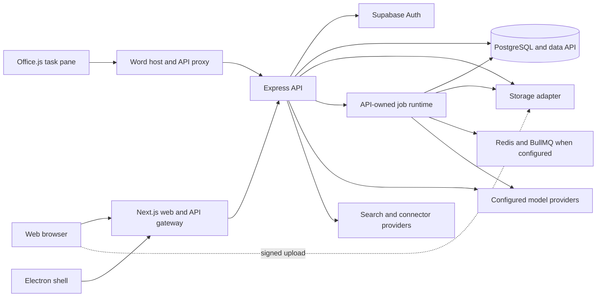

# NorthWrit current implementation

Reviewed November 14, 2026 against the merged repository. This is the current implementation reference. The [implementation plan](../07-implementation/NorthWrit-Implementation-Plan.md) governs delivery; product specifications define target behaviour.

## Application surfaces and stack

| Area | Current implementation | Source |
|---|---|---|
| Web | TypeScript, Next.js 16, React 19, Tailwind CSS 4; Tiptap for editor surfaces | [Web manifest](../../apps/web/package.json) |
| API | TypeScript on Node.js 22+, Express 5, Zod; domain modules behind service facades | [API manifest](../../apps/api/package.json), [backend architecture](../engineering/backend-architecture.md) |
| Database and authentication | Supabase PostgreSQL, Auth, REST data API and gateway; API-owned schema and migrations | [Schema](../../apps/api/schema.sql), [local infrastructure](../../infra/docker-compose.yml) |
| Background work | API-owned job services, durable database jobs and Redis/BullMQ adapters; standalone worker launcher | [Worker guide](../../apps/worker/README.md), [backend architecture](../engineering/backend-architecture.md) |
| File storage | S3-compatible API; local Compose uses RustFS | [Local development](../engineering/local-development.md) |
| Word | Office.js, React and TypeScript, webpack build and HTTPS development host | [Word guide](../../apps/word-addin/README.md) |
| Desktop | Electron shell; macOS packaging configuration | [Desktop guide](../../apps/desktop/README.md) |
| Shared code | `@northwrit/contracts`, `@northwrit/client`, `@northwrit/ui`; framework-free client behaviour and shared UI | [Ownership map](NorthWrit-Repository-Ownership.md) |
| Installation and checks | Nine private npm workspaces, one root lockfile; Vitest, Node tests, TypeScript, ESLint and Playwright tooling | [Root commands](../../package.json), [CI inventory](../07-implementation/NorthWrit-CI-Inventory.md) |

The older [architecture stack](Northwrit_Architecture-Stack.md) and [v3 repository blueprint](Northwrit_Repo-Structure.md) preserve earlier proposals. Their Fastify, Python services, Tauri, pnpm/uv and additional service/package boundaries are not the current implementation or approved replacement instructions. Additional technology changes require a recorded decision.

## Existing foundation and planned product work

| Area | Current baseline | Next delivery work |
|---|---|---|
| Workspace and documents | Projects, document storage/processing, sharing and access helpers | Phase 4: coherent Matter terminology, navigation and verified two-user/two-matter journeys |
| Assistance, review and drafting | Assistant, Library, Tabular Reviews, workflows and Word integration from the imported foundation | Phases 4–5: evidence/version continuity, Canadian workflows and version-bound review/approval |
| Research and governance | Existing search/provider/connector infrastructure | Phase 5: permitted Canadian sources, Bearings, four-state CiteCheck and Shield enforcement |
| Integrations | Existing connector, agent and tool infrastructure; availability depends on configuration | Phase 6: pilot-selected integrations with tested permissions, revocation and external-write approval |
| Release | Builds, unit/route tests and seven PR checks passed for the merged application baseline | Phase 7: pilot journeys, security/operations evidence and release readiness |

These are source-backed building blocks, not an acceptance claim for the planned NorthWrit workflows. Phase 4 has not started. Canadian residency, provider contracts, Local Only execution, certification and production readiness require separate evidence.

## Current names and configuration

Use NorthWrit for the product, NorthWritX for the repository, and `@northwrit/*` for active package identities. [Configuration verification](../07-implementation/NorthWrit-Configuration-Verification.md) documents protected historical and compatibility identifiers. Review current source and compatibility tests before changing stored identifiers. PR #5 subsequently aligned configuration and identifiers, and PR #6 retired the duplicate source archive under [ADR 0004](../decisions/0004-retire-source-reference-archive.md); earlier verification evidence describes its original revision.

Development uses localhost. NorthWrit `.local` addresses in examples are placeholders; the application does not host production Terms or Privacy pages at them. Configure `NEXT_PUBLIC_NORTHWRIT_TERMS_URL`, `NEXT_PUBLIC_NORTHWRIT_PRIVACY_URL` and `NEXT_PUBLIC_NORTHWRIT_SUPPORT_EMAIL` for the intended environment. Do not use reserved `.invalid` build-test URLs in a release.

API, server and Word error reporting require an explicit operator DSN. Browser reports use the same-origin monitoring tunnel and are discarded when its server destination is unconfigured. See [observability](../engineering/observability.md). Optional provider and connector calls need their own configuration and credentials.

## Evidence and limits

[PR #4](https://github.com/VenkataAnilKumar/NorthWritX/pull/4) merged as `d7e899526a389cbbe684b18618b32df98ccea237`, with all seven PR checks passing. This records that PR's result, not the status of later commits. Earlier [migration](../07-implementation/NorthWrit-Migration-Verification.md) and [workspace](../07-implementation/NorthWrit-Workspace-Verification.md) records retain their original local verification scope.

Active CI covers repository/branding guards, backend, frontend, Word, and API/web/Word container builds; the API image job also builds the worker. It does not establish real browser/database acceptance, signed desktop packaging, Office-host acceptance or production deployment. See the [CI inventory](../07-implementation/NorthWrit-CI-Inventory.md) for inactive imported workflows and remaining checks.

The latest pulled baseline is `7c08dba`, including PRs #5 and #6. Current attribution lives in [source provenance](NorthWrit-Source-Provenance.md), [Credit.md](../../Credit.md), [NOTICE.md](../../NOTICE.md) and [LICENSE](../../LICENSE). The retired source-reference archive is retained in Git history, not the current tree.

## Runtime topology

The diagram describes logical communication, not mandatory deployment units. The standalone worker uses API-owned code rather than duplicating domain services. Redis/BullMQ supports specific asynchronous paths; durable database jobs and in-memory streaming runs are different mechanisms. Desktop local mode has its own loopback gateway and bundled-service arrangement; see the [desktop guide](../../apps/desktop/README.md). For the filesystem storage adapter, signed uploads reach an API endpoint rather than an external bucket.

## Application and dependency boundaries

| Boundary | Responsibility | Implementation reference |
|---|---|---|
| Web client and gateway | UI composition, safe API calls and same-origin forwarding | [API client](../../apps/web/src/app/lib/northwritApi.ts), [gateway](../../apps/web/src/app/api/[...path]/route.ts) |
| HTTP routes | Parse requests, apply request middleware, invoke services and map results; SSE lifetime remains in streaming routes | [API composition](../../apps/api/src/app.ts) |
| Domain modules | Documents, projects, chat, tabular review, playbooks, workflows, users and organizations; external callers use service facades | [Domain modules](../../apps/api/src/modules/) |
| Cross-domain application services | Account, purge, export and job orchestration that span domains | [Application layer](../../apps/api/src/application/) |
| Shared kernel and middleware | Access helpers, storage, providers, queues, diagnostics and request plumbing; no dependency on domain implementation | [Shared kernel](../../apps/api/src/lib/), [middleware](../../apps/api/src/middleware/) |
| Shared TypeScript packages | Serialized contracts, framework-free client behaviour and shared UI | [Contracts](../../packages/contracts/), [client](../../packages/client/), [UI](../../packages/ui/) |
| Worker process | Runtime composition, shutdown and API-owned job execution | [Worker launcher](../../apps/worker/README.md) |

These boundaries are enforced in part by [architecture tests](../../apps/api/src/__tests__/architecture.test.ts) and [dependency-cycle tests](../../apps/api/src/__tests__/dependencyCycles.test.ts). See the [backend architecture](../engineering/backend-architecture.md) for service contracts and permitted streaming exceptions.

## State and data ownership

| State | Owner and persistence | Important limit |
|---|---|---|
| Accounts and sessions | Supabase Auth; API-managed HttpOnly session cookies | Authentication is distinct from organization/item authorization |
| Workspaces and item access | API domains and PostgreSQL schema/migrations | Organization membership does not grant unrestricted private-content access |
| Original bytes, staging and renditions | Storage adapter; database records reference objects/versions | Bucket/filesystem permissions and signed URL handling need their own configuration |
| Derived document text | PostgreSQL text records bound to document versions and text revisions | Failed extraction and incomplete OCR must not be represented as complete evidence |
| Chat transcripts | Conversation domain persistence | Live replay frames in a process are not a durable transcript or workflow checkpoint |
| Generation frames | Server-owned in-memory runs | Reconnect behaviour does not promise cross-process recovery |
| Durable work | Database job records or configured BullMQ queues, depending on operation | Retry, lease and cancellation semantics are operation-specific |
| Provider/connector credentials | API-managed encrypted credential records or operator environment | Personal, organization and user/workspace connector credentials are different scopes |
| Memory | User/workspace and project records | Reference context does not authorize access or override instructions |

The [schema](../../apps/api/schema.sql) defines current persistence; the [proposed data model](Northwrit_Data-Model.md) describes target requirements. Do not treat proposed entities, vector search or legal-hold policies as delivered merely because they appear in a design.

## Trust boundaries and operational failure

The API must evaluate the authenticated actor, workspace, item access and requested operation. Job execution and artifact publication/download occur later and need their own current-access checks. The [system flows](NorthWrit-System-Flows.md) identify those handoffs; Phase 4 still needs complete two-user/two-matter acceptance evidence.

Model providers, web search and connectors are separate outbound paths. A local model configuration does not constrain all those paths. Connector content and model output remain untrusted; permitted external actions depend on the connection, tool, scope and approval policy. Planned Shield enforcement must cover all relevant paths rather than just the chat endpoint.

Rate limits, input/body bounds, operation-specific job retries and safe error responses exist in the API. A deployment still needs correct secrets, TLS, storage/auth origins, worker configuration and backup/restore procedures. Consult the [administrator guide](../guides/administrator.md), [deployment guide](../engineering/deployment.md) and [observability guide](../engineering/observability.md). Do not infer measured capacity or recovery targets from repository layout.

## Related references

- [Product catalogue](../02-product/NorthWrit-Product-Catalogue.md): current surfaces, configuration and limitations.
- [System flows](NorthWrit-System-Flows.md): session, ingestion, generation, tools, export and offboarding.
- [Capability matrix](../04-specs/NorthWrit-Capability-Matrix.md): target requirements and remaining work.
- [Documentation coverage](../07-implementation/NorthWrit-Documentation-Coverage.md): source and guide traceability.
