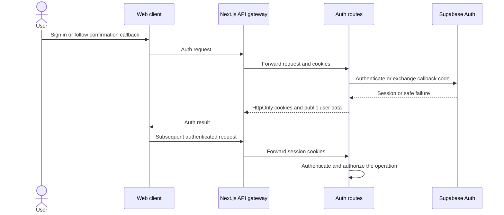
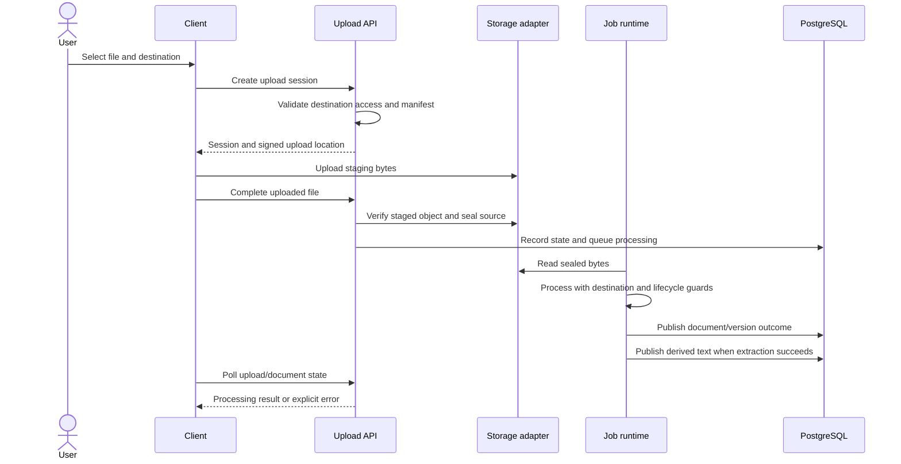
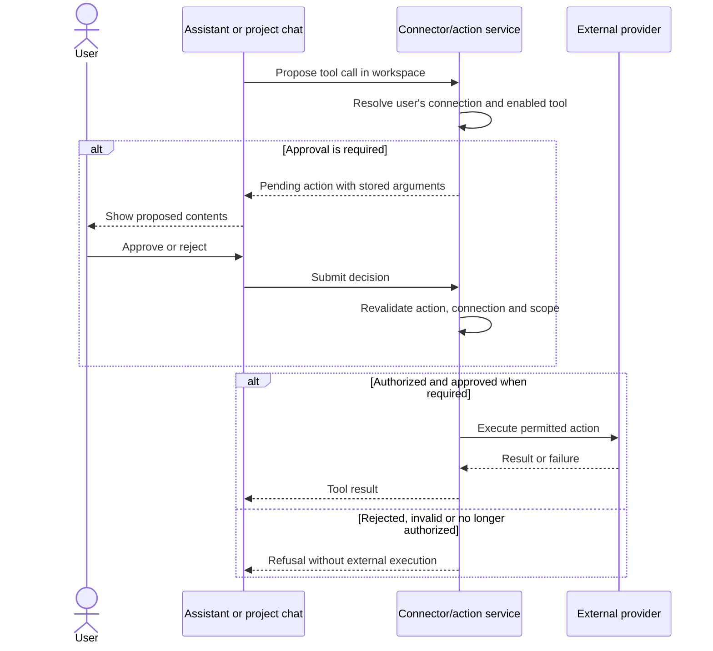

# NorthWrit system flows

Reviewed November 14, 2026 at baseline `7c08dba`. These flows describe current code paths. They are a source review, not a record of executed browser/database/provider acceptance tests. Endpoint paths below are API-relative; web clients normally reach them through the same-origin `/api` gateway.

## Sign-in and session

Sign-up, email verification, reset, SSO and MFA are distinct routes with configuration requirements. A successful login is not authorization for every organization or item. The API applies trusted-origin and session handling; the client should display the safe API error rather than raw provider internals.

Evidence: [auth routes](../../apps/api/src/modules/auth/auth.routes.ts), [session handling](../../apps/api/src/lib/authSession.ts), [gateway](../../apps/web/src/app/api/[...path]/route.ts), [auth refresh route tests](../../apps/api/src/__tests__/integration/authRefreshFanOut.routes.test.ts).

## Upload, processing and searchable text

A signed URL authorizes a bounded transfer; it is not a permanent content entitlement. Completion verifies/seals the staged object before processing. The S3 adapter allows direct object upload; the filesystem adapter uses a signed API transfer endpoint instead. Processing and text extraction are separate work, so successful transfer does not mean searchable content is ready.

Stored text publication checks the version's text revision. A late job must not overwrite newer text or repopulate a deleted version. Document formats may require LibreOffice or other processing dependencies; scanned-page extraction does not establish complete OCR coverage.

Evidence: [upload routes](../../apps/api/src/modules/uploads/uploads.routes.ts), [sessions and sealing](../../apps/api/src/modules/uploads/uploads.sessions.ts), [processing](../../apps/api/src/modules/uploads/uploads.processing.ts), [access checks](../../apps/api/src/modules/uploads/uploads.access.ts), [text lifecycle](../engineering/document-text-search.md), [upload route tests](../../apps/api/src/__tests__/integration/uploadSessions.complete.routes.test.ts).

## Assistant generation and reconnect

1. The client sends a message with selected model and workspace/context identifiers.
2. The API prepares the conversation, resolves access and permitted model/tool configuration, and registers the assistant turn.
3. The server writes model/tool frames to a server-owned run and fans them out over SSE. Conversation persistence is separate from replaying live frames.
4. A reconnecting reader can attach using the run/sequence information while the owning process still has that run. Closing a response detaches it; an explicit Stop requests cancellation.
5. The route persists the terminal/partial answer and exposes the outcome. A second concurrent turn can be refused with `turn_in_progress`.

An in-memory replay buffer is not durable workflow checkpointing across process restarts or replicas. Durable database/BullMQ jobs have different retry and recovery rules. Optional web, connector or subagent tools add separate outbound paths; their availability is not implied by the chat model alone.

Evidence: [chat routes](../../apps/api/src/modules/chat/chat.routes.ts), [project chat](../../apps/api/src/modules/project-chat/projectChat.routes.ts), [run registry](../../apps/api/src/lib/streamRuns.ts), [run contracts](../engineering/backend-architecture.md#server-owned-runs), [project-chat route tests](../../apps/api/src/__tests__/integration/projectChat.routes.test.ts).

## Tabular extraction and playbook review

A tabular review selects documents and extraction questions. Generation claims the review lease and publishes cell updates. The synchronous path can expose a server-owned generation stream; the optional asynchronous path uses BullMQ workers and database-backed progress. A viewer is not automatically allowed to generate or stop work. The in-process Stop endpoint is not a promise that it cancels every asynchronous worker job.

Playbook import parses a guide into structured rules and source references. A contract review uses saved-rule content snapshots, so a later playbook edit does not silently change the historical review input. Failed compilation, inaccessible documents and model failures must remain distinct outcomes. Existing review output is not the proposed Folio version-bound approval process.

Evidence: [tabular routes](../../apps/api/src/modules/tabular/tabular.routes.ts), [playbook domain](../../apps/api/src/modules/playbooks/), [playbook lifecycle](../engineering/playbooks.md), [tabular route tests](../../apps/api/src/__tests__/integration/tabular.routes.test.ts).

## Connector action and approval

This is the approval-capable path, not a claim that every MCP write requires approval: MCP settings can permit unapproved writes. Google Drive, Gmail and Calendar also permit direct writes when `require_write_approval` is disabled. When enabled, the stored proposed action requires approval before execution. Pending actions must be invalidated when their relevant connection/tool configuration changes. Word and Tabular Reviews cannot display the required MCP write approval UI and refuse those actions. Connector content is untrusted input even when it comes from an authorized account.

Evidence: [MCP controls](../engineering/connectors.md#write-actions-and-approvals), [Google actions](../engineering/google-workspace.md), [connector route tests](../../apps/api/src/__tests__/integration/connectors.routes.test.ts).

## Download, export and integrity

A download/export request enters through the relevant authenticated or signed route. Access helpers and application services resolve eligible documents and versions; storage provides the bytes. A queued export must check current access when it executes, not rely only on admission-time permissions. The Phase 4 acceptance suite must cover denied and revoked access across these paths.

Project manifests record hashes and accept/reject history. Optional Ed25519 signing is a separate configuration. A matching hash verifies byte integrity relative to the manifest; it does not prove source accuracy, legal correctness or approval of the output version. Historical versions without hashes remain unverifiable.

Evidence: [downloads](../../apps/api/src/modules/downloads/), [export application services](../../apps/api/src/application/exports/), [integrity format](../engineering/tamper-evident-exports.md).

## Departure and recovery

When a member leaves or is removed, the organization lifecycle rules distinguish shared work, remaining owners and private ownerless content. Work can be retained/transferred or archived under the documented retention rules. Archive listing and recovery are owner-only; ordinary administrator access does not expose private titles. Credentials for the departing member's organization connections are removed, while their Personal connections remain separate.

Evidence: [offboarding and recovery](../engineering/organization-offboarding.md), [organization domain](../../apps/api/src/modules/orgs/), [organization route tests](../../apps/api/src/__tests__/integration/orgs.routes.test.ts).

## Acceptance work still required

For pilot acceptance, run these journeys with synthetic fixtures, authorized and denied actors, and stated service configuration. Include source replacement/deletion, membership revocation during queued work, retries, cancellation, connector changes before approval, and worker/process failure. Existing test files are evidence of automated checks available in the repository, not evidence that this documentation pass executed live integrations.
