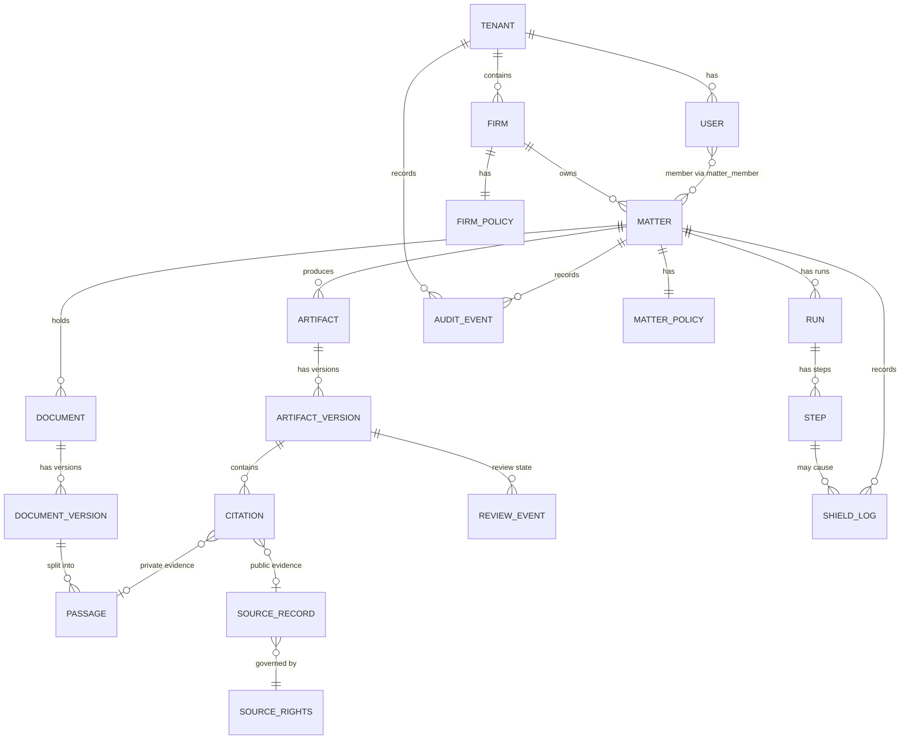

# Data Model

> Requirements reconciliation — November 9, 2026. The [Workflow Contracts](../04-specs/Northwrit_Workflow-Contracts.md) govern review invalidation, export eligibility, lifecycle handoffs, and baseline release scope. Architectural approval does not establish implementation status.
## Entities, relationships, isolation and retention

**Version:** 1.0 | **Date:** November 3, 2026 | **Status:** Proposed (nothing is built yet)

---

## 1. Conventions

- Primary store: PostgreSQL (proposed; see [Architecture Stack](Northwrit_Architecture-Stack.md)). Original files and exports in encrypted object storage, referenced by key and hash.
- All ids are UUIDs. All times are UTC `timestamptz`.
- Every table below `tenant` carries `tenant_id`. Matter-scoped tables also carry `matter_id`. Row-level security policies enforce both (SA01); application checks are a second layer, not the only one.
- Matter content is never stored in logs. `shield_log` and `audit_event` hold identifiers, categories and hashes.
- Feature IDs refer to the [Feature Specification](../04-specs/Northwrit_Feature-Spec.md).

## 2. Entity relationship diagram

## 3. Entities

### 3.1 tenant

The top isolation boundary: one customer organisation (a firm or an in-house team).

| Field | Notes |
|---|---|
| `id`, `name`, `status` | |
| `region` | Data region, for example `ca-central`. Residency is evaluated against it (SA12). |
| `tier` | `cloud` or `firm_server` (see [Deployment Architecture](Northwrit_Deployment-Architecture.md)). |
| `kms_key_ref` | Key reference for this tenant's data (SA02). |
| `created_at` | |

### 3.2 firm

A practice unit inside a tenant (a tenant may have one or several). Carries the firm policy (SH01, SA08), retention defaults (SA05), house style (CU02) and seat settings (SA13).

| Field | Notes |
|---|---|
| `id`, `tenant_id`, `name` | |
| `firm_policy_id` | Mode, allowed providers, regions, categories, budgets, policy version. |
| `retention_default` | Days or rule; see §5. |
| `settings` | jsonb: branding, citation style default, language. |

### 3.3 user

| Field | Notes |
|---|---|
| `id`, `tenant_id`, `email`, `display_name`, `status` | |
| `role` | `admin`, `partner`, `associate`, `paralegal`, `reviewer`, `guest` (SA07). |
| `mfa_enrolled` | Required for all users (SA03). |
| `idp_subject` | SSO identity (SA10, P1). |
| `preferences` | jsonb: jurisdiction, citation style (McGill Guide or Bluebook), language, theme (CU01). |

Membership: `matter_member(matter_id, user_id, matter_role, added_by, added_at)`. `ethical_wall(matter_id, user_id, reason, created_by)` blocks access everywhere, including search and agents (SA11, P1).

### 3.4 matter

| Field | Notes |
|---|---|
| `id`, `tenant_id`, `firm_id`, `name`, `client_matter_number` | MT01. |
| `status` | `open`, `archived`, `legal_hold` (MT08, P2), `deleted`. |
| `matter_policy_id` | Processing mode (`local_only`, `hybrid`, `cloud`), jurisdiction, source scope, redaction requirement, policy version (MT03). Stricter of firm and matter wins at evaluation time. |
| `instructions` | Standing guidance (MT02). |
| `retention_override` | Optional; cannot loosen a firm minimum. |
| `created_by`, `created_at` | |

The matter row and its membership are created and committed **before** any document is accepted (MT01).

### 3.5 document and document_version

| Field | Notes |
|---|---|
| `document.id`, `matter_id`, `name`, `kind`, `current_version_id` | |
| `document.restrictions` | Document-level permissions that narrow matter access (RV02). |
| `document_version.id`, `version_no`, `object_key`, `sha256`, `size`, `mime_type` | Original stored unchanged. |
| `source_location` | Where it came from: upload, connector id and path, email message id (RV02, RV04). |
| `ingest_status` | `queued`, `processing`, `indexed`, `indexed_keyword_only`, `failed`, `needs_ocr`. |
| `ingest_error` | Plain reason naming the document (RV01). |
| `parsed_by`, `parsed_at` | Parser name and version, for reproducibility. |
| `doc_type`, `metadata` | From Auto-Sort (RV05, P1). |
| `duplicate_of` | Duplicate detection (RV05, P1). |

### 3.6 passage

The unit of evidence for private documents.

| Field | Notes |
|---|---|
| `id`, `document_version_id`, `matter_id`, `tenant_id` | Matter id denormalised for filters. |
| `ordinal`, `page`, `locator` | Page, paragraph or character offsets so the viewer opens at the exact spot (AS01). |
| `text` | Extracted text, stored in the tenant store only. |
| `text_hash` | Detects changed evidence. |
| `tsv` | Full-text vector. |
| `embedding` | Vector column (optional until embedded, may be absent for keyword-only). |
| `acl_tags` | Inherited restrictions from document and matter. |

A new document version creates new passages; old passages remain so earlier citations stay resolvable.

### 3.7 source_record and source_rights

Public and licensed legal sources.

| `source_record` field | Notes |
|---|---|
| `id`, `provider`, `source_type` | Statute, case, regulation, secondary, web. |
| `canonical_ref` | Neutral citation or URL, jurisdiction, court, decision date. |
| `retrieved_at`, `content_hash` | Retrieval time (evidence contract). |
| `snippet_ref` | Stored text only if rights permit; otherwise a pointer and locator. |
| `rights_id` | Link to `source_rights`. |

| `source_rights` field | Notes |
|---|---|
| `provider`, `terms_version`, `terms_ref` | The contract or terms reviewed. |
| `retrieval`, `storage`, `processing`, `display`, `export`, `retention` | Each: allowed, conditions, limits. |
| `geography`, `entitlements` | Confirmed per customer. |
| `reviewed_by`, `reviewed_at` | |

### 3.8 artifact, artifact_version

Folios: memos, tables, drafts (SO02).

| Field | Notes |
|---|---|
| `artifact.id`, `matter_id`, `kind`, `title`, `current_version_id` | |
| `artifact.review_state` | Derived from the current version; see below. |
| `artifact_version.id`, `version_no`, `content` (structured document JSON), `created_by`, `created_at`, `change_summary` | Content is structured so citations are anchored to spans (SO04). |
| `artifact_version.evidence_fingerprint` | Hash of the set of cited passage and source hashes. A change invalidates approval. |
| `produced_by_run_id` | Link to the run, if any. |
| `model_identity` | Model and provider that produced generated text (AS02). |

### 3.9 citation

| Field | Notes |
|---|---|
| `id`, `artifact_version_id`, `matter_id` | |
| `anchor` | Span or block in the folio the claim covers. |
| `evidence_kind` | `matter_document`, `public_source`, `library_item`, `none`. |
| `passage_id` / `source_record_id` / `library_item_id` | Exactly one, matching kind. `none` marks uncited text visibly. |
| `locator` | Precise supporting location. |
| `source_version_or_retrieved_at` | Evidence contract. |
| `jurisdiction` | When known. |
| `resolution_status` | `resolved`, `unresolved`. |
| `support_label` | `verified`, `unverified`, `contradicted`, `unavailable` (RS05). `verified` only after a support check. |
| `checked_by` | `citecheck` run id and model identity. |
| `reviewer_decision` | `accepted`, `rejected`, `pending`, with user id. |

Private-document citations inherit the document's restrictions: a user who cannot read the passage sees the citation as restricted, not its text.

### 3.10 review state

Review is event-sourced so history and reviewer identity are preserved.

| `review_event` field | Notes |
|---|---|
| `id`, `artifact_version_id`, `matter_id` | |
| `from_state`, `to_state` | `draft`, `in_review`, `changes_requested`, `approved`. |
| `actor_user_id`, `comment`, `occurred_at` | |
| `reason` | `submitted`, `requested_changes`, `approved`, `invalidated_edit`, `invalidated_evidence`. |

**Invariants:** approval belongs to one `artifact_version_id`. A substantive edit creates a new version in `draft`. A changed `evidence_fingerprint` (for example the source document was replaced) emits `invalidated_evidence` and returns the version to `in_review`. Export records the version and state used (SO05).

### 3.11 run and step

| `run` field | Notes |
|---|---|
| `id`, `tenant_id`, `matter_id`, `workflow`, `initiated_by` | AG01. |
| `status` | `queued`, `running`, `awaiting_approval`, `succeeded`, `failed`, `cancelled`, `partial`. |
| `policy_version` | Policy applied when started. |
| `budget`, `usage` | Task budget and consumption (SA06). |
| `started_at`, `ended_at` | |

| `step` field | Notes |
|---|---|
| `id`, `run_id`, `ordinal`, `kind` | `retrieve`, `search`, `model_call`, `citecheck`, `draft`, `checkpoint`, `tool_write`. |
| `status` | `pending`, `running`, `succeeded`, `failed`, `blocked`, `skipped`, `cancelled`. |
| `input_ref`, `output_ref` | References to stored step data (tenant store), not copies in logs. |
| `tool`, `tool_outcome` | AG02. |
| `model`, `provider`, `usage` | Identity and consumption. |
| `idempotency_key` | Prevents duplicate writes on retry. |
| `checkpoint` | Required approval, approver, approved payload hash (AG03). |
| `block_reason` | Rule id when blocked by policy. |
| `error` | Reason and whether resumable. |

### 3.12 shield_log

Schema and rules are in [Hybrid AI Architecture](Northwrit_Hybrid-AI-Architecture.md) §8. Append-only; no payload text.

### 3.13 audit_event

| Field | Notes |
|---|---|
| `id`, `tenant_id`, `matter_id` (nullable), `occurred_at` | |
| `actor_type`, `actor_id` | `user`, `agent_run`, `system`, `admin`. |
| `action` | For example `document.uploaded`, `model.called`, `policy.changed`, `artifact.approved`, `export.created`, `access.denied`, `retention.deleted`. |
| `object_type`, `object_id` | |
| `details` | jsonb with identifiers, old and new values for settings; no matter text. |
| `request_id`, `ip`, `client` | Correlation. |
| `prev_hash`, `hash` | Hash chain to detect tampering (proposed). |

Append-only: no update or delete permissions for the application role. Export at P1 (SA09).

### 3.14 Other entities (summary)

| Entity | Purpose | Features |
|---|---|---|
| `fact` | Fact Sheet items with provenance to passages | MT04 |
| `memory_entry` | Scoped `personal`, `matter` or `firm_approved`, with provenance and deletion scope | CU03 |
| `library_item` | Precedents, templates, playbooks with owner and version | RV06, DR02 |
| `agent_definition`, `agent_version` | Agents and Packs | AG04, AG05, CN03 |
| `connector`, `connector_grant` | Connector config and credentials reference (secret store) | CN02 |
| `usage_record` | Rates, budgets and cost per user, matter and run | SA06 |
| `eval_run`, `eval_task` | Northwrit Bench results (internal; no customer data) | QA01 |

## 4. Isolation rules

| Rule | Implementation (proposed) |
|---|---|
| **Tenant** | `tenant_id` on every row; row-level security keyed on a session setting; separate encryption keys per tenant; object keys prefixed by tenant. A firm-server tenant is a physically separate deployment. |
| **Matter** | Queries must include matter authorisation: membership, document restrictions and ethical walls evaluated in the query filter, not after results return. |
| **Retrieval** | Vector and keyword indexes filter on `tenant_id`, `matter_id` and `acl_tags` before ranking. Cross-matter search (SO01) is the union of matters the user may see, computed per request. |
| **Memory** | Entries are scoped; no automatic transfer between matters or to firm knowledge; promotion to firm knowledge is an explicit, approved operation (CU03). |
| **Agents and tools** | Run credentials are those of the initiating user and the matter; connector results are tagged with matter and ACL on arrival. |
| **Citations** | Evidence inherits source restrictions; export checks that the exporting user can read each cited passage. |
| **Guests** | Client Room guests are members of a specific scope only (MT07, P1). |
| **Testing** | Adversarial tests per release across retrieval, artifacts, memory and connector results; zero disclosures is the gate. |

## 5. Retention and deletion (SA05, MT08)

| Data | Default behaviour (proposed) | Notes |
|---|---|---|
| Matter content (documents, passages, artifacts) | Retained until the firm's retention rule or an authorised deletion. | Firm sets retention days or "until matter closed plus N". Matter override cannot be shorter than the firm minimum. |
| Deletion | Soft delete with a short recovery window, then hard delete of rows, objects, vectors and caches; key-based crypto-erasure as a supplement. | Backups age out on their own schedule (documented per tier). |
| Legal hold (P2) | Blocks deletion and retention expiry for the matter. | Audit events record hold and release. |
| `run` and `step` data | Follows matter retention. | Sensitive step payloads can have a shorter retention than metadata. |
| `shield_log` | Retained at least as long as the matter plus a firm-set audit period. | Contains no payloads, so it may outlive content. |
| `audit_event` | Firm-set audit period; not deleted with the matter. | Deleted records keep identifiers only. |
| Restore maps (redaction) | Deleted at run retention expiry or earlier. | Never exported. |
| Provider-side retention | Governed by contract; zero or minimal retention terms and no-training required (SA04). | Recorded in adapter data terms. |
| Source records | Per `source_rights` retention limits. | Some sources may not permit storing text. |
| Export (portability) | JSON plus original files; excludes other tenants and restricted items the exporter cannot read. | Cross-cutting. |

Deleting a user does not delete their audit events; the actor reference is preserved with limited personal information per the firm's privacy configuration (see [Security and Compliance](Northwrit_Security-Compliance.md)).

## 6. Indexing guidance

- `passage(matter_id, document_version_id, ordinal)`; GIN on `tsv`; vector index on `embedding`, always combined with matter filter.
- `citation(artifact_version_id)`, `citation(passage_id)`, `citation(source_record_id)`.
- `audit_event(tenant_id, occurred_at)`, `audit_event(matter_id, occurred_at)`.
- `shield_log(matter_id, occurred_at)`, `shield_log(run_id)`.
- Partition `audit_event` and `shield_log` by month at scale.
