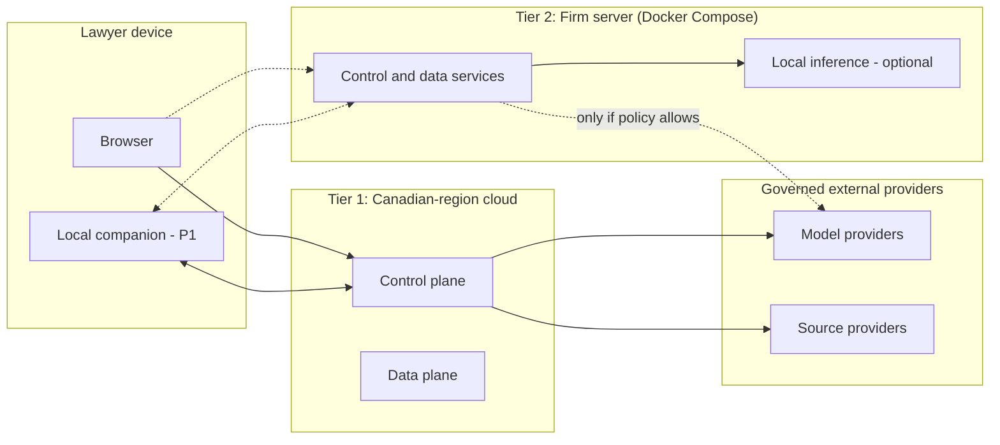
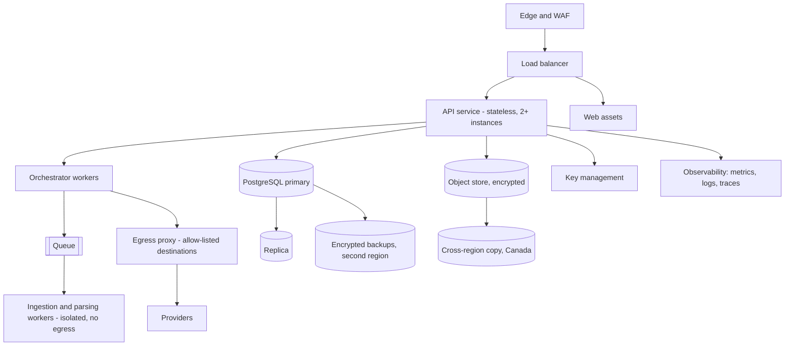

# Deployment Architecture
## Canadian-region cloud, firm server and local companion

**Version:** 1.0 | **Date:** November 3, 2026 | **Status:** Proposed (nothing is built yet)

---

## 1. Deployment tiers

Northwrit is a cloud web application with two optional tiers for firms that need more control. Feature IDs refer to the [Feature Specification](../04-specs/Northwrit_Feature-Spec.md). Related: [System Architecture](Northwrit_System-Architecture.md), [Hybrid AI Architecture](Northwrit_Hybrid-AI-Architecture.md), [Security and Compliance](Northwrit_Security-Compliance.md).

| Tier | Where it runs | Who operates it | Phase | Notes |
|---|---|---|---|---|
| **1. Canadian-region cloud** | Northwrit control and data planes in a Canadian cloud region | Northwrit | P0 | Default. Shared infrastructure with logical tenant isolation. |
| **2. Firm server** | Docker Compose on a server the firm controls (on premises or the firm's own Canadian cloud account) | Firm IT, with Northwrit support | Proposed P1 (to be confirmed with design partners) | Data and processing stay inside the firm's environment. |
| **3. Local companion** | A desktop service on a lawyer's computer, paired with tier 1 or 2 | User, managed by the firm | P1 (SH05) | Local parsing, indexing, storage, optional inference. Not a standalone product. |

Full desktop and offline mode is a separate P2 capability (SH08).

## 2. Tier 1: Canadian-region cloud

**Regions:** a primary Canadian region and a second Canadian region for backup and recovery (for example two regions in different provinces, subject to cloud vendor choice). Customer content, indexes, backups and logs remain in Canada (SA02, SA12). Provider availability must be confirmed.

| Aspect | Proposal |
|---|---|
| **Compute** | Containers on a managed container platform; stateless API; autoscaled workers. |
| **Tenant isolation** | Logical (row-level security, per-tenant keys). A dedicated database or deployment per tenant can be offered for firms that require it. |
| **Network** | Private subnets; only the edge is public; workers have no internet access; a single egress proxy with a destination allow-list, which Shield and the gateways use. |
| **Secrets and keys** | Managed secret store and KMS in the Canadian region. |
| **Identity** | OIDC and SAML; MFA required (SA03, SA10). |
| **Model providers** | Reached only through the Model Gateway; region and terms per adapter. A provider outside Canada is available only when the firm's policy allows it. |
| **Support access** | No standing access to tenant content; break-glass with customer approval and audit. |

## 3. Tier 2: Firm server (Docker Compose)

For firms that want data and processing inside their own environment.

**Services (proposed Compose services):**

| Service | Purpose |
|---|---|
| `proxy` | TLS termination and routing |
| `web` | Static web app |
| `api` | API, authorisation, orchestrator |
| `worker` | Ingestion, parsing, OCR, CiteCheck jobs |
| `postgres` | Database with full-text and vector extension |
| `objectstore` | S3-compatible storage for originals and exports |
| `shield-egress` | Egress proxy that enforces Shield destination rules; deny by default |
| `llm-local` (optional) | Local inference runtime (requires GPU or sufficient CPU, hardware profile to be certified) |
| `otel-collector` (optional) | Observability, content-free |

**Operating requirements (proposed)**

| Topic | Proposal |
|---|---|
| **Compose files** | Versioned images; one `compose.yaml`, an `.env` template, and a hardened override example. Secrets via Docker secrets or a file-based secret store; no secrets in environment files committed to source. |
| **Network** | Internal Docker network for services; only `proxy` published. `worker` and `llm-local` have no external route. |
| **Local Only matters** | `shield-egress` denies all external destinations for these matters; egress tests run in the installer's self-check. |
| **Updates** | Signed release bundles delivered by the firm's chosen channel; version pinning; migration scripts with a dry-run; rollback to the previous bundle plus database backup. |
| **Licensing and control plane** | A firm-server deployment must run without sending protected content or operational metadata to Northwrit's cloud. Any optional licence check or update notification carries no matter data and can be disabled for air-gapped installs. |
| **Backups** | A documented script for database dump and object store copy; encryption; restore drill; firm responsibility, Northwrit guidance. |
| **Sizing** | Reference sizing table per number of users and document volume, produced from pilot measurements. Not yet measured. |
| **Support** | Diagnostic bundle that excludes content; reviewed by the firm before sharing. |
| **Limits** | Some features that depend on Northwrit-operated services (for example managed legal-source access, shared Pack directory) may be unavailable or need firm-supplied credentials; the feature matrix per tier is to be documented. |

A Compose deployment is suited to single-node pilots and small firms. High availability and Kubernetes packaging are not proposed for the first release.

## 4. Local companion (SH05, P1)

| Aspect | Proposal |
|---|---|
| **Form** | Installable desktop application with a local background service, paired to a tenant by an admin-issued enrolment code or SSO sign-in. |
| **Functions** | Folder access limited to folders the user selects; local parsing and indexing; encrypted local storage with device-bound keys; optional local inference; status panel for connection, resource use and active tasks. |
| **Sync** | Matter metadata and artifacts sync per policy; local-only content stays local. Memory sync is a governed outbound category (SH04). |
| **Policy** | The companion fetches the effective matter policy and enforces it locally. If it cannot reach the control plane it keeps the last signed policy (with expiry) and refuses actions needing a fresh decision. |
| **Local Only** | Supported tasks are the validated subset (see [Hybrid AI Architecture](Northwrit_Hybrid-AI-Architecture.md) §9); other tasks are blocked. |
| **Updates** | Signed updates, minimum version enforcement by admin. |
| **Uninstall and revoke** | Admin can revoke a device; local store is wiped or keys destroyed on revocation at next contact. |
| **Hardware profile** | To be defined with the chosen local model (open decision). |

## 5. Environments

| Environment | Purpose | Data | Notes |
|---|---|---|---|
| **Local development** | Developer machines using Compose | Synthetic only | Same images as production |
| **CI** | Build, test, scan | Synthetic | Isolation and egress tests run here |
| **Evaluation** | Northwrit Bench | Lawyer-reviewed synthetic and consented sets; held-out set kept separate | Reruns after model, retrieval, prompt, tool or policy changes (QA01) |
| **Staging** | Pre-release verification, mirrors production topology in Canadian region | Synthetic | Release gates run here |
| **Production** | Customer service | Customer content | Restricted access, change control |
| **Pilot (design partner)** | Production with feature flags | Customer content | Tight support and feedback loop |

Customer content never appears in non-production environments. Production data is not copied for debugging.

**Release process (proposed):** code review; automated tests; security and dependency scans; Bench; isolation and egress tests; staged rollout with feature flags (SA13); rollback plan; change record. Policy or prompt changes follow the same path as code.

## 6. Backup, recovery and retention

| Item | Proposal |
|---|---|
| **Database** | Continuous archiving with point-in-time recovery; daily snapshots; encrypted; copied to the second Canadian region. |
| **Object store** | Versioning and cross-region replication within Canada. |
| **Indexes** | Rebuildable from passages; backups optional. |
| **Keys** | Key backup and rotation procedure; key loss is data loss, so recovery is documented. |
| **RPO and RTO** | Targets to be set with design partners, for example separate targets for pilot and general availability; not yet committed. |
| **Restore testing** | Scheduled restore drills with recorded results; at least before pilot and after major changes. |
| **Deletion and backups** | Deleted data ages out of backups by a stated window; the window is disclosed to customers (SA05). |
| **Disaster recovery** | Documented runbook for region failure; failover to second Canadian region; no failover outside Canada without customer consent. |
| **Tenant export** | Matter export as JSON plus original files on request (portability). |

## 7. Observability

| Signal | Content rules |
|---|---|
| **Metrics** | Request rates, error rates, queue depth, ingestion latency, model latency and cost, blocked-step counts, citation outcomes. Aggregated; no matter content. |
| **Logs** | Structured; identifiers, status and error codes only; redaction filters in the logger; log lines checked in tests for payload text. |
| **Traces** | OpenTelemetry spans with ids and timings; attributes allow-listed. |
| **Audit and Shield Log** | Stored in the database (SA09, SH03), separate from operational logs. |
| **Usage and budgets** | Per user, matter and run (SA06); visible to admins. |
| **Quality telemetry** | Bench results and production quality indicators (for example reviewer rejection rates, share of Unverified citations), aggregated by tenant, no content. |
| **Alerts** | Service health, error budget, backup failure, certificate and key expiry, repeated policy blocks, unusual export volumes, sign-in anomalies. |
| **On-call and incidents** | Runbooks and a severity scale; status page; post-incident review. |
| **Local and firm-server tiers** | Telemetry off by default for Local Only matters and for air-gapped installs; any export is a categorised outbound item (SH04). |

## 8. Capacity and cost controls

- Autoscaling on queue depth for workers; limits on concurrent runs per tenant.
- Task budgets and rate limits (SA06).
- Cost per accepted artifact and p50 and p95 completion time recorded from pilot (SA14, planning measures).
- Model provider quotas monitored; fallback only through policy-eligible routes.

## 9. Open items

1. Cloud vendor and the pair of Canadian regions.
2. Whether Tier 2 ships at P1 or earlier based on design partner requirements.
3. Reference sizing and the local inference hardware profile.
4. RPO and RTO targets.
5. Firm-server feature matrix and update channel.
