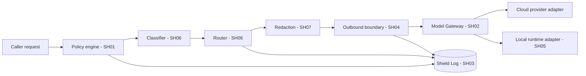

# Hybrid AI Architecture
## Shield: policy, routing, redaction, outbound boundary and local companion

**Version:** 1.0 | **Date:** November 3, 2026 | **Status:** Proposed (nothing is built yet)

---

## 1. Purpose

Shield decides, per matter and per step, what may leave the firm's environment, and records what did. It implements SH01 to SH07 of the [Feature Specification](../04-specs/Northwrit_Feature-Spec.md). Context: [System Architecture](Northwrit_System-Architecture.md). Storage of the log: [Data Model](Northwrit_Data-Model.md). Interfaces: [API Design](Northwrit_API-Design.md).

Hybrid means coordinated local and cloud storage, retrieval, inference and execution. These are independent choices. A local app or local tool runner does not mean inference stays local.

## 2. Components

| Component | Role | Priority |
|---|---|---|
| **Processing Policy engine** | Evaluates firm and matter policy. The stricter setting wins. | P0 (SH01) |
| **Model Gateway** | One internal interface over cloud models and local runtimes. Records usage, model and provider identity. | P0 (SH02) |
| **Shield Log** | Records every cloud send. | P0 (SH03) |
| **Outbound boundary** | Applies policy to every kind of outbound data. | P0 (SH04) |
| **Local companion** | Local parsing, indexing, storage and optional inference. | P1 (SH05) |
| **Smart Routing** | Classifies requests; picks among permitted routes. | P1 (SH06) |
| **Redact and Restore** | Replaces sensitive terms before the cloud and restores them after. | P1 (SH07) |

At P0, routing is rule-based: the policy decides whether the single configured provider route is permitted. Classification and cost or latency optimisation arrive at P1.

## 3. Model Gateway (SH02, CN01)

The gateway is the only code path to a model. Each adapter declares its capabilities and constraints so the router can reason about them.

**Adapter descriptor (proposed)**

| Field | Meaning |
|---|---|
| `adapter_id`, `provider`, `model` | Identity shown to the user (AS02) and recorded in the Run Trail (AG02). |
| `location` | `cloud` or `local`. |
| `region` | Processing region (for example `ca-central`, `us`, `unknown`). `unknown` is ineligible where residency is required. |
| `capabilities` | Chat, structured output, embeddings, long context, vision, tool use. |
| `data_terms` | Reference to the contract record: no-training (SA04), retention, sub-processors. |
| `limits` | Context size, rate, cost per unit. |
| `status` | Enabled, disabled by Model Policy (SA08), or degraded. |

**Gateway contract**

1. Receive a request containing matter id, user id, purpose, capability needed, and payload references (not raw copies where avoidable).
2. Call Shield for a decision. Without an `allow` decision, the gateway refuses.
3. Send, then return the response with provider and model identity and usage.
4. Emit an audit event for every call, and a Shield Log entry for every cloud send.

Direct provider calls from any other module are a defect. A build-time check and a network egress rule should enforce this (proposed).

## 4. Processing Policy (SH01, MT03, SA08, SA12)

| Mode | Documents and indexes | Inference | External calls | When capability is unavailable |
|---|---|---|---|---|
| **Local Only** | Approved local environment | Local runtime only | Blocked | Use already available local sources and show their freshness; otherwise block the step. |
| **Hybrid** | Local preprocessing and private retrieval, plus permitted cloud research or inference | Permitted local or cloud | Each outbound payload checked | Stop, or use a permitted alternative. |
| **Cloud** | Approved cloud environment | Configured cloud models | Respect provider, region, access, retention and budget | Fail the step visibly. |

**Resolution:** firm policy and matter policy are both evaluated. The stricter wins, ordered Local Only > Hybrid > Cloud. A matter can tighten but never loosen the firm policy.

**Policy record (proposed fields):** mode, allowed providers and models, allowed regions, allowed data categories per destination, source scope, redaction requirement, budget, policy version, effective time.

The matter's mode, jurisdiction and source scope are visible at all times in the workspace (MT03). Policy changes are audit events recording old and new values.

**Scope at P0:** enforcement for Hybrid and Cloud with provider visibility. Local Only requires working local inference (SH05, P1) and must not be advertised before it passes isolation tests. A matter set to Local Only before SH05 exists can store documents and use keyword search but blocks every model step.

## 5. Router and classification (SH06, P1)

Inputs: data classification, matter restrictions, provider and region eligibility, task capability, available hardware, cost, latency.

| Class | Meaning | Example | Default handling |
|---|---|---|---|
| **Confidential** | Contains matter content or client-identifying facts | Summarise this agreement | Local route, or cloud only if policy permits and redaction applies. |
| **Mixed** | Public question with matter-derived context | Research a rule given these facts | Split: public query built from a minimal, redacted formulation; matter content stays in the firm boundary. |
| **Public** | No matter content | Look up a statute | Any permitted route. |

**Algorithm (proposed)**

1. Build the candidate set from all adapters and sources.
2. Remove candidates failing **hard constraints**: policy mode, allowed provider, region, category allowed for destination, capability, Model Policy, ethical wall.
3. If the set is empty, return `blocked_by_policy` (never fall through to cloud).
4. Among the remainder, optimise by cost and latency within the task budget (SA06).
5. Record the chosen route and the rule that allowed it.

Classification is a recommendation that can only tighten handling. A user or admin can mark a matter or document as confidential; a classifier result of "public" never overrides a matter restriction. Classifier accuracy is measured in Northwrit Bench (QA01).

## 6. Redact and Restore (SH07, P1)

1. Detect names, companies, amounts, addresses and other configured entities in the outbound payload.
2. Replace each with a stable placeholder (`PARTY_1`, `AMOUNT_2`) scoped to the request.
3. Hold the restore map in the tenant store, encrypted, linked to the run, and never sent out.
4. After the response, restore originals locally and mark restored text so reviewers can see it.
5. Delete the map on the retention schedule for the run.

**Limits (stated in the product):** redaction reduces exposure but does not guarantee anonymity. Contextual facts (a rare event, a small town, a unique dollar figure) may still identify the matter. Detection can miss entities. Policy can require redaction and also forbid sending a category even after redaction. Redaction quality is evaluated in Northwrit Bench.

## 7. Outbound boundary (SH04)

Policy is applied to everything that can carry matter information out, not only chat prompts.

| Category | Examples | Typical handling |
|---|---|---|
| `prompt` | Messages and system instructions sent to a model | Policy check; redact if required. |
| `research_query` | Queries to legal or web search | Build from minimal terms; check for matter facts. |
| `excerpt` | Document passages added to context | Allowed only if matter policy permits that provider and region. |
| `tool_parameter` | Arguments to connectors, MCP and Pack tools | Validate against tool schema and policy; approval for writes (AG03). |
| `embedding` | Passages sent to an embedding model | Same as excerpt; vectors can leak content, so treated as matter data. |
| `screenshot` | Images of screens or pages | Blocked unless policy lists the category. |
| `log` | Diagnostic and application logs sent to external services | No matter content; identifiers only. |
| `telemetry` | Product analytics | Aggregate and content-free; off by default for Local Only. |
| `memory_sync` | Synchronisation of memory entries between local and cloud | Only for the memory scope allowed (CU03); no cross-matter transfer. |

**Rules**

- The check runs on the **final** payload, after redaction and truncation.
- A category not listed as allowed for a destination is denied by default.
- Data leaves a matter only through model calls, web search, connectors, MCP tools and Pack tools. Each passes the gateway and is audited.
- A local-only deployment must not depend on cloud orchestration that carries protected content or operational metadata outside the boundary.

## 8. Shield Log (SH03)

One entry per cloud send, written **before** the send completes. It stores references and categories, not duplicate payloads.

| Field | Type | Notes |
|---|---|---|
| `id` | uuid | |
| `tenant_id`, `matter_id` | uuid | |
| `user_id` | uuid | Who initiated the call. |
| `run_id`, `step_id` | uuid, nullable | Link to the run if the send was part of one. |
| `occurred_at` | timestamptz | |
| `destination_type` | enum | `model`, `search`, `connector`, `mcp`, `pack_tool`, `telemetry`. |
| `provider`, `model`, `region` | text | Region as reported by the adapter contract. |
| `data_categories` | text[] | From the outbound boundary table. |
| `payload_ref` | text, nullable | Pointer to the run step (or hash), not the payload. |
| `payload_size` | int | Characters or tokens. |
| `source_count` | int | Number of passages or documents included. |
| `redaction_applied` | bool | |
| `decision` | enum | `allowed`, `blocked`, `allowed_with_redaction`. |
| `rule_id`, `policy_version` | text | The rule that allowed or blocked, and the policy version. |
| `status` | enum | `sent`, `failed`, `cancelled`. |
| `usage` | jsonb | Tokens and cost, filled on completion. |

Blocked decisions are also recorded so admins can see attempted sends. Entries are append-only, and are visible to admins and to authorised reviewers per matter. A Shield Log view per matter answers: who sent what category to which model and region, when, and under which rule.

## 9. Local companion and Local Only validation (SH05, P1)

**Companion functions:** permission-scoped folder access, local parsing and indexing, encrypted local storage, optional local model inference. It shows connection status, local resource use and active tasks. Details: [Deployment Architecture](Northwrit_Deployment-Architecture.md).

**Local Only is separate from local tooling.** A task counts as Local Only only if parsing, retrieval, inference, tools and operational records all stay in the approved environment.

**Validation plan (proposed)**

| Test | Method | Pass criterion |
|---|---|---|
| Egress | Run each supported Local Only workflow with network monitoring at process and network boundary and a deny-all egress rule. | Zero unapproved connections. |
| Dependency | Run with the control plane unreachable. | Workflow completes, or is blocked with a clear message; no hidden fallback. |
| Telemetry | Inspect logs and crash reports. | No matter content or identifiers leave. |
| Capability | Run the Northwrit Bench subset designated for Local Only. | Quality meets the gate set for that subset; unsupported tasks are listed. |
| Fallback | Disable the local runtime. | Step blocked; no silent escalation to cloud. |

**Supported subset:** to be defined from what the chosen local model and hardware profile can do (open decisions on local model and hardware). Anything outside it is blocked in Local Only, with an explanation. Full local-only capability is not marketed until these tests pass.

## 10. Blocked-step behaviour

A block is a result, not an error to be worked around.

1. The step stops. Completed steps are preserved.
2. The caller receives `blocked_by_policy` with: the rule id, the category denied, the destination, and permitted alternatives (for example "run locally", "narrow the sources", "ask an admin to allow provider X").
3. The user sees the reason in plain language in the run view, with the alternatives as actions.
4. The Shield Log and audit trail record the block.
5. The workflow may continue with later steps that do not depend on the blocked one, and the output states the gap.
6. The system never changes jurisdiction, source coverage, model location or scope to complete a response.

An admin can change policy; that is a separate audited action. A user cannot override a block, and a blocked step can be retried after a policy change under a new policy version.

## 11. Threats handled here

| Threat | Mitigation |
|---|---|
| A module bypasses the gateway | Single code path, egress allow-list, tests. |
| Prompt injection asks for exfiltration | Retrieved text is untrusted; tool parameters validated against schema and policy; outbound check runs on every call regardless of model output. See [Security and Compliance](Northwrit_Security-Compliance.md). |
| Region drift at a provider | Region is part of the adapter contract and is rechecked by configuration review. Unknown region is ineligible when residency is required. |
| Log leakage | Log entries hold references, not payloads. |
| Redaction miss | Residual-risk wording, optional blocking of categories, evaluation in Bench. |
