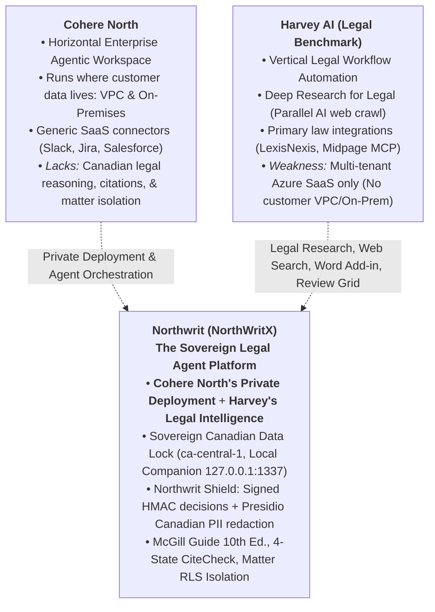

# Northwrit Platform Layers & Surfaces Specification

> Requirements reconciliation — November 9, 2026. The [Workflow Contracts](../04-specs/Northwrit_Workflow-Contracts.md) govern review invalidation, export eligibility, lifecycle handoffs, and baseline release scope. Architectural approval does not establish implementation status.
## Architectural Synthesis: Cohere North Private Agentics × Harvey AI Legal Intelligence

**Status:** Approved Architectural Specification | **Version:** 2.0 | **Date:** November 5, 2026  
**Document Code:** `NW-ARCH-LAYERS-SURFACES-01`  
**Cross-References:** [System Architecture](Northwrit_System-Architecture.md) | [Architecture Stack](Northwrit_Architecture-Stack.md) | [Competitive Analysis](../03-market/Northwrit_Competitive-Analysis.md) | [Feature Spec](../04-specs/Northwrit_Feature-Spec.md)

---

## 1. Executive Synthesis: The "North for Legal" Thesis



### The Market Vacuum
1. **The Limitations of Horizontal Platforms (Cohere North):** While Cohere North delivers the premier private infrastructure model (running in customer VPCs or on-premises), it lacks legal-domain reasoning: it has no comprehension of Canadian court hierarchies (Supreme Court of Canada vs. Ontario Court of Appeal), no McGill Guide 10th Edition citation parser, no 4-state authority classification discipline, and no Matter-scoped confidentiality boundaries.
2. **The Sovereign Friction of Vertical Platforms (Harvey AI):** Harvey AI is the legal industry benchmark for workflows and deep research. However, Harvey operates almost exclusively as a **multi-tenant cloud SaaS hosted on Microsoft Azure**. It does not provide turnkey on-premise or customer-managed VPC installations. For Canadian law firms bound by Law Society of Ontario (LSO) Rule 3.3 (Client Confidentiality), Quebec Law 25, and PIPEDA, transmitting unredacted privileged matter files to US multi-tenant clouds creates severe regulatory, insurance, and professional responsibility barriers.
3. **Northwrit's Architectural Mandate:** Combine **Cohere North's private, customer-hosted deployment models** with **Harvey AI's deep legal domain intelligence**, customized specifically for Canadian and Commonwealth jurisdictions.

---

## 2. The 6 Core Platform Layers

```text
┌────────────────────────────────────────────────────────────────────────────────────────────────┐
│                          LAYER 1: CLIENT SURFACES & USER EXPERIENCE                            │
│  Harvey: Assistant Chat, Document Store, Workflows, Word Add-in, Mobile                        │
│  Northwrit: Matter Workspace, Folio Editor, Review Grid, Word Add-in, Local Companion          │
├────────────────────────────────────────────────────────────────────────────────────────────────┤
│                          LAYER 2: LEGAL CAPABILITY & DOMAIN WORKFLOWS                          │
│  Harvey: Deep Research for Legal, Contract Analysis, Redlining, Citations, Playbooks           │
│  Northwrit: Bearings, 4-State CiteCheck, Review Grid, Ontario Calculators, Court Book Compiler │
├────────────────────────────────────────────────────────────────────────────────────────────────┤
│                          LAYER 3: AGENT RUNTIME & ORCHESTRATION                                │
│  Harvey: Multi-agent planner/searcher/drafter, Tool calling, Background jobs                   │
│  Northwrit: LangGraph Legal Engine, Review Grid extraction, Starter Agent Workflows             │
├────────────────────────────────────────────────────────────────────────────────────────────────┤
│                          LAYER 4: RETRIEVAL, PRIMARY LAW & KNOWLEDGE GRAPH                     │
│  Harvey: LexisNexis / Midpage MCP, Parallel AI web crawl, Vector + Lexical RAG                 │
│  Northwrit: CanLII REST API, Onyx parser, Pinpoint locators (RV01), PostgreSQL 16 + pgvector   │
├────────────────────────────────────────────────────────────────────────────────────────────────┤
│                          LAYER 5: SECURITY, PRIVACY & GOVERNANCE (SHIELD)                      │
│  Harvey: Multi-tenant Azure encryption, SOC 2, Vendor-managed cloud isolation                  │
│  Northwrit: Northwrit Shield, HMAC-signed ShieldDecisions, Canadian PII Redaction, Matter RLS │
├────────────────────────────────────────────────────────────────────────────────────────────────┤
│                          LAYER 6: INFRASTRUCTURE & SOVEREIGN DEPLOYMENT                        │
│  Harvey: Microsoft Azure Hosted Cloud SaaS only (No customer VPC or On-Prem)                   │
│  Northwrit: Canadian Cloud (ca-central-1), Turnkey Firm-Server (DP02), Local Companion         │
└────────────────────────────────────────────────────────────────────────────────────────────────┘
```

---

### Layer 1: Client Surfaces & User Experience

Lawyers interact with Northwrit through a unified design system (`#0F172A` Deep Slate, `#1D4ED8` Authority Blue, `#FAF9F5` Paper Warm):

* **Matter Command Centre (`apps/web/src/app/workspace`):** Unified hub housing matter metadata, counsel directory, matter fact sheets (`MT04`), case chronology timeline (`SO09`), and upcoming Ontario court deadlines.
* **Legal Assistant Chat Studio:** Threaded conversational interface with pre-search **Bearings** dialogue (`RS01`), dynamic follow-up recommendations, and inline citation chips linking to pinpoint source documents.
* **Folio Drafting Studio:** Tiptap-powered rich-text legal drafting surface with automated citation chip injection, version-bound review gates (`draft → under_review → approved`) (`SO03`), and tracked changes diff export.
* **Review Grid Extractor (`apps/web/src/app/workspace`):** Multi-document tabular contract analysis and due diligence workspace with pinpoint evidence drawer and CSV/Excel export.
* **Sovereign Document Store & Viewer:** Split-pane legal document viewer with Bates stamping (`RV04`), OCR text overlay, SHA-256 version chains (`RV02`), and synchronized text-to-coordinate bounding box highlighting.
* **Flow Builder Canvas (`apps/web/src/app/flow-builder`):** Visual drag-and-drop node-edge editor wrapping `@northwrit/flow-renderer` for no-code legal automation assembly.

---

### Layer 2: Legal Capability & Domain Workflows

* **Autonomous Deep Legal Research Engine:** Multi-turn recursive reasoning workflow that decomposes complex questions, searches CanLII and Canadian statutes, reads decisions, cross-references authorities, and synthesizes structured memoranda.
* **Strict 4-State CiteCheck Authority Discipline (`RS05`):** Classifies all citations into deterministic states:
  * `verified`: Authority confirmed active and standing under Canadian appellate hierarchy.
  * `unverified`: Citation resolved, but subsequent treatment requires judicial consideration verification.
  * `contradicted`: Authority distinguished, overruled, or questioned by higher courts.
  * `unavailable`: Authority not indexed or record inaccessible.
* **Ontario Procedural Calculators (`SO11`):**
  * *Limitations Act, 2002:* 2-year general discovery bar and 15-year ultimate limitation period.
  * *Courts of Justice Act* s. 128: Prejudgment and postjudgment interest rates and accrual calculations.
* **Court Book of Authorities Compiler (`SO12`):** Automated assembly of indexed, tabbed court books with CiteCheck treatment badges, ready for filing before the Ontario Court of Appeal or Superior Court of Justice.
* **Bilingual Bijural Translation Engine (`services/bilingual-mt`):** High-fidelity translation between English Common Law and French Civil Code terminology preserving statutory definitions.

---

### Layer 3: Agent Runtime & Orchestration

* **LangGraph Legal Engine (`services/legal-engine`):** Directed acyclic graph orchestration with specialized sub-agents:
  * *Research Planner:* Formulates legal search queries and identifies court jurisdiction.
  * *Authority Reader:* Parses full-text judgments and identifies *ratio decidendi*.
  * *Citator Evaluator:* Traces appellate history and assigns 4-state CiteCheck status.
  * *Folio Drafter:* Synthesizes legal analysis adhering strictly to McGill Guide 10th Ed. rules.
* **Tool Calling & MCP Protocol (`packages/mcp-server`):** Standardized Model Context Protocol server and client exposing matter search, document retrieval, and citation verification to local agents under strict Shield inspection.
* **Human-in-the-Loop Review Gates:** Enforces version-bound approval workflows (`draft → under_review → approved`). Any modification to approved content recalculates the cryptographic SHA-256 hash and immediately reverts the Folio to `draft`.
* **Asynchronous Distributed Job Queue:** High-throughput job processing for heavy batch operations (500+ document Review Grid extractions, Bates stamping, and Court Book compilation).

---

### Layer 4: Retrieval, Primary Law & Knowledge Graph

* **Primary Canadian Law Grounding:** Direct integration with the CanLII REST API (`/v1/caseSearch/en/`, `/v1/caseBrowse/en/`), e-Laws Ontario, and Justice Laws Canada.
* **Sovereign Canadian Legal Crawler:** Containerized, telemetry-free search and scraping sidecar (SearXNG + headless browser) capable of indexing dynamic tribunal portals (e.g. Ontario Land Tribunal, LAT, Human Rights Tribunal of Ontario).
* **Legal Ingestion & Parsing Pipeline (`services/ingest-worker`):** Onyx-derived layout-aware parser extracting text, tables, and hierarchical section/paragraph locators (`RV01`).
* **Hybrid Retrieval & Precision Legal Reranking:** BM25 full-text keyword search combined with `pgvector` dense embeddings, followed by a dedicated legal point reranker (Cohere Rerank / BGE-Reranker) that prioritizes authoritative holdings over incidental commentary.
* **Enterprise Legal DMS Connectors (`packages/connectors`):** Bi-directional synchronization with **iManage Work 10**, **NetDocuments REST**, **SharePoint Legal Libraries**, and **Clio**, strictly honoring upstream Access Control Lists (ACLs).

---

### Layer 5: Security, Privacy & Governance (Northwrit Shield)

* **Zero-Bypass Model Gateway (`packages/gateway`):** Physical network isolation ensuring that no model request can execute without a cryptographically verified `ShieldDecision` token signed via HMAC-SHA256 (`SH01`, `SH02`).
* **Canadian PII Redaction Engine (`services/shield-pii`):** Microsoft Presidio extended with custom regex and context recognizers for Canadian Social Insurance Numbers (SIN), postal codes, Ontario court file numbers, and Law Society of Ontario (LSO) counsel IDs (`SH07`).
* **Reversible Pseudonym Store:** Secure token substitution mapping sensitive client identifiers to reversible placeholders before cloud egress, with deterministic restoration upon response receipt.
* **Matter-Scoped Row-Level Security (`SA01`):** Every database query executed via `@northwrit/db` runs within a transaction that explicitly sets:
  ```sql
  SET LOCAL northwrit.tenant_id = 'ten_firm_01';
  SET LOCAL northwrit.matter_id = 'mat_litigation_005';
  ```
  Physical database-level enforcement prevents cross-matter data leakage.
* **Litigation Hold & Ethical Walls (`SA11`):** Cryptographic deletion blocks on matters subject to litigation preservation orders, combined with firm-level ethical screening barriers.
* **Customer-Managed Encryption Keys (BYOK KMS `SA14`):** Envelope encryption supported via AWS KMS (`ca-central-1`) and Azure Key Vault (`canadaeast`).

---

### Layer 6: Infrastructure & Sovereign Deployment

* **Tier 1: Sovereign Canadian Cloud:** Multi-tenant or dedicated SaaS provisioned strictly within AWS Canada Central (`ca-central-1`) or Azure Canada East (`canadaeast`).
* **Tier 2: Customer-Managed Private Cloud (VPC):** Complete deployment within the firm's private AWS or Azure subscription via Terraform and Kubernetes Helm manifests, ensuring zero data leaves the firm's cloud perimeter.
* **Tier 3: Turnkey On-Premise Firm-Server (`deploy/firm-server`):** Self-contained Docker Compose appliance engineered for firm server rooms, featuring air-gapped local model serving (vLLM running quantized open-weight legal models).
* **Tier 4: Zero-Egress Local Companion (`apps/companion`):** Tauri 2.0 Rust desktop runtime bound exclusively to `127.0.0.1:1337` for fully offline, disconnected legal drafting.

---

## 3. The 5 Portals and Surfaces Specification

```text
┌────────────────────────────────────────────────────────────────────────────────────────┐
│                              NORTHWRIT PORTALS & SURFACES                              │
├────────────────────────────────────────────────────────────────────────────────────────┤
│  1. END-USER LEGAL WORKSPACE (WEB)     │  2. EMBEDDED WORK SURFACES (IN-SITU)          │
│  • Matter Command Centre               │  • Microsoft Word Task-Pane Add-in (Office.js)│
│  • Legal Assistant Chat Studio         │  • Microsoft Outlook Email/Attachment Add-in  │
│  • Folio Drafting Studio (Tiptap)      │  • Sovereign Browser Extension (CanLII/e-Laws)│
│  • Review Grid Batch Extractor         │  • Local Companion Desktop App (Tauri 2.0)    │
│  • Sovereign Document Store Viewer     │                                               │
│  • Flow Builder No-Code Canvas         │                                               │
├────────────────────────────────────────┴───────────────────────────────────────────────┤
│  3. LAW FIRM CONTROL CENTRE (ADMIN PORTAL)                                             │
│  • 6-Role Legal RBAC, SSO (SAML/OIDC), SCIM 2.0 User Provisioning                      │
│  • Ethical Walls & Matter Screening Rules                                              │
│  • Shield Governance & PII Redaction Policy Engine                                     │
│  • Firm Spend, Token Metering & Client Disbursement Billing Reports                     │
├────────────────────────────────────────────────────────────────────────────────────────┤
│  4. DEVELOPER & INTEGRATION PORTAL     │  5. ON-PREM / VPC OPERATIONS CONSOLE          │
│  • REST API & OpenAPI/Swagger Console  │  • Turnkey Firm-Server Health & Telemetry     │
│  • Model Context Protocol (MCP) Hub    │  • Private GPU Serving Monitor (vLLM)         │
│  • Webhooks & Legal Event Triggers     │  • Air-Gapped Licence Key Validator           │
└────────────────────────────────────────┴───────────────────────────────────────────────┘
```

### Surface 1: End-User Legal Workspace (Web Portal)
* **Architecture:** Next.js 15 App Router (`apps/web`) with server-side rendering, streaming SSE responses, and responsive desktop layout.
* **Key Workspaces:**
  * `/workspace`: Matter switcher, interactive Bearings dialogue, legal research, fact sheets, and procedural calculators.
  * `/folio`: Structured legal authoring environment with real-time citation chips, McGill Guide format validation, and review state progression.
  * `/review-grid`: Multi-document tabular comparison with pinpoint evidence drawers.
  * `/flow-builder`: Node-edge visual workflow automation studio.

### Surface 2: Embedded Client Work Surfaces (In-Situ)
1. **Microsoft Word Task-Pane Add-in (`apps/word-addin`):**
   * Built on Microsoft Office.js.
   * Enables in-Word legal Q&A grounded in matter documents.
   * Scans draft contracts against firm clause playbooks and inserts suggested redlines.
   * Performs real-time CiteCheck verification on selected text and formats citations to McGill Guide 10th Ed.
2. **Microsoft Outlook Add-in (Planned):**
   * One-click ingestion of email threads and PDF attachments directly into the Matter Document Store with Bates stamping.
   * Client privilege and PII detector scanning outbound drafts.
3. **Sovereign Browser Extension (Planned):**
   * "Send to Matter" web clipper for CanLII, Westlaw, LexisNexis, SEDAR+, and court dockets.
   * In-browser CiteCheck badge overlay highlighting legal citations on public websites.
4. **Local Companion Desktop App (`apps/companion`):**
   * Tauri 2.0 Rust desktop shell.
   * Bound strictly to loopback interface `127.0.0.1:1337`.
   * Air-gapped local document ingestion and offline vector store for sensitive travel or litigation war rooms.

### Surface 3: Law Firm Control Centre (Admin Portal)
* **Architecture:** Located at `/control-centre` in `apps/web`.
* **Administrative Controls:**
  * **6-Role Legal RBAC (`SA04`):** Managing Partner, Partner, Senior Associate, Associate, Paralegal, and In-House Counsel.
  * **Single Sign-On & Directory Sync:** SAML 2.0 / OIDC authentication with SCIM 2.0 automated provisioning for Azure AD (Entra ID) and Okta.
  * **Ethical Wall Screening:** Matter-specific access restrictions with automatic conflict audit logging.
  * **Shield Policy Manager:** Granular enforcement of `local_only`, `redacted_cloud`, or `approved_cloud` per practice group or client.
  * **Disbursement Billing Export:** Per-matter token consumption, storage utilization, and model costs formatted for direct inclusion on client invoices.

### Surface 4: Developer & Integration Portal
* **Interactive OpenAPI/Swagger Console:** Complete endpoint documentation for `/v1/matters`, `/v1/folios`, `/v1/research`, and `/v1/citecheck`.
* **Model Context Protocol (MCP) Hub:** Test bench for Northwrit's MCP server and management interface for registering external legal MCP tools.
* **Webhook Subscription Manager:** Event subscriptions for `document.ingested`, `folio.review_approved`, `citecheck.contradicted`, and `matter.hold_enabled`.

### Surface 5: On-Premise & VPC Operations Console
* **Diagnostics Dashboard:** Health probes (`/healthz`, `/readyz`), database pool metrics, and Redis job queue telemetry.
* **Private GPU Serving Monitor:** Real-time VRAM utilization, inference throughput, and latency tracking for local vLLM / Ollama instances.
* **Air-Gapped Licence Key Validator:** Cryptographically signed offline licence verification for firm-server deployments without internet connectivity.

---

## 4. Implementation Roadmap & Gap Priorities

| Priority | Component | Target Directory | Description |
|---|---|---|---|
| **P1** | **Autonomous Deep Legal Research Agent** | `services/legal-engine/app/workflows/deep_research.py` | Multi-step recursive research loop (Decompose $\to$ CanLII + Web Search $\to$ Evidence Read $\to$ CiteCheck $\to$ McGill Memo Synthesis). |
| **P1** | **Sovereign Web & Tribunal Crawler** | `services/legal-engine/app/connectors/crawler.py` | Containerized SearXNG / headless crawler for dynamic court dockets and tribunal portals. |
| **P2** | **Visual Flow Builder UI** | `apps/web/src/app/flow-builder/page.tsx` | Visual drag-and-drop workflow canvas wiring `@northwrit/flow-renderer` to legal nodes. |
| **P2** | **Enterprise Legal DMS Connectors** | `packages/connectors/src/{imanage,netdocuments}/` | Bi-directional synchronization for iManage Work 10 and NetDocuments with ACL preservation. |
| **P3** | **Precision Legal Reranker** | `packages/gateway/src/reranker.ts` | Integration of Cohere Rerank / BGE-Reranker for legal point reranking. |
| **P3** | **One-Click Customer VPC Appliance** | `deploy/vpc-terraform/` | Terraform infrastructure-as-code manifests for AWS `ca-central-1` and Azure `canadaeast`. |
