# Modern Architecture & Repository Structure
## Historical enterprise monorepo proposal for Northwrit (v3.0)

**Version:** 3.0 | **Date:** November 5, 2026 | **Status:** Historical proposal; superseded for current delivery

**Document Code:** `NW-ARCH-REPO-STRUCTURE-03`  
**Cross-References:** [Platform Layers & Surfaces](Northwrit_Platform-Layers-and-Surfaces.md) | [Architecture Stack](Northwrit_Architecture-Stack.md) | [System Architecture](Northwrit_System-Architecture.md) | [Marketing & GTM](../03-market/Northwrit_Marketing-and-GTM-Strategy.md)

The [NorthWrit implementation plan](../07-implementation/NorthWrit-Implementation-Plan.md#repository-organization-before-phase-4) governs current repository work. It keeps `apps/northwrit/` through Phase 4 and makes later application, package and worker extraction conditional on operating evidence. The platforms, services and guarantees described below are historical proposals, not verified NorthWrit capabilities or mandatory implementation steps.

---

## 1. Architectural Philosophy: The Sovereign Enterprise Monorepo

As Northwrit scales into an enterprise-grade legal AI platform, it unifies multiple client **surfaces**, specialized administrative and marketing **portals**, and diverse **deployment tiers** within a single **Sovereign Enterprise Monorepo** (**Monorepo at build time, Independent Microservices at runtime**):

1. **TypeScript (`pnpm` + Turborepo) — Client Surfaces, Control Plane & Core Packages:**
   * Powers `apps/web` (Lawyer Workspace, Folio Editor, Review Grid, Flow Builder), `apps/marketing`, `apps/control-centre`, `apps/word-addin`, `apps/outlook-addin`, `apps/browser-extension`, and shared `packages/*`.
   * Enforces end-to-end type safety via Zod, PostgreSQL Row-Level Security via Drizzle ORM (`packages/db`), the Zero-Bypass Model Gateway (`packages/gateway`), and tamper-evident Audit Logging (`packages/audit`).
2. **Python 3.12 (`uv` Workspace) — Sovereign AI, Document Intelligence & Legal Research:**
   * Powers `services/shield-pii`, `services/legal-engine`, `services/crawler`, `services/ingest-worker`, `services/ocr-worker`, `services/review-grid`, `services/bilingual-mt`, and `bench/`.
   * Leverages native Python ecosystems: **Microsoft Presidio** (`services/shield-pii`), **IBM Docling** and **Onyx File Processing** (`services/ingest-worker`), **SearXNG & Playwright** (`services/crawler`), and **LangGraph** (`services/legal-engine`).
3. **Rust (`Cargo` / Tauri 2.0) — Zero-Egress Local Companion (`apps/companion`):**
   * High-performance desktop runtime executing on loopback `127.0.0.1:1337` for air-gapped, zero-network document analysis and drafting.
4. **Declarative Infrastructure as Code (`deploy/`):**
   * Production-grade infrastructure automation: Turnkey On-Premises Firm-Server (`deploy/firm-server`), Customer VPC Terraform (`deploy/vpc-terraform`), and Production Kubernetes (`deploy/helm`).

---

## 2. Why the v3.0 Monorepo Outperforms Multi-Repo Architectures

| Dimension | Separate Module Repos (Multi-Repo) | **Northwrit v3.0 Enterprise Monorepo** |
|---|---|---|
| **Cross-Stack Feature Velocity** | Slow: Changing a CiteCheck schema or Shield decision rule requires 4–5 coordinated PRs across separate repositories and publishing intermediate packages. | **Atomic & Instant:** One PR updates the contract (`packages/contracts`), the Python research engine (`services/legal-engine`), the API control plane (`packages/api`), the React UI (`apps/web`), and the Word add-in (`apps/word-addin`). |
| **Schema & Type Drift** | High risk of JSON payload mismatch between Python microservices and TypeScript APIs. | **Zero Drift:** `@northwrit/contracts` generates TypeScript types and Python Pydantic v2 models from the same source of truth. |
| **Surface & Portal Specialization** | Coupling marketing with core software leads to deployment bottlenecks and security risks. | **Isolated App Lifecycles:** Marketing sites (`apps/marketing`) deploy independently to edge CDNs without touching core legal backends, while sharing the `@northwrit/ui` design tokens. |
| **Runtime Scalability** | Each repository deploys as an independent service. | **Identical Runtime Scalability:** Every folder in `apps/` and `services/` builds an isolated Docker image and scales independently on Kubernetes/ECS. |
| **Law Firm Security & SOC 2 Audits** | Auditors must inspect multiple repositories to verify that no service bypassed `shield` or database Row-Level Security. | **Single Sovereign Audit Boundary:** One CI gate enforces that no component can invoke an LLM without `packages/shield` or query PostgreSQL without `packages/db`. |
| **Canadian Legal Evaluation Benchmark** | Difficult to coordinate benchmarks across split repositories. | Every PR touching prompts, parsers, or CiteCheck automatically executes against `bench/` (50 Canadian legal evaluation tasks). |

### Four Laws Keeping the Monorepo Scalable at 10x Growth
1. **Monorepo in Git, Independent Fleet in Production:** `services/ingest-worker` (CPU/OCR heavy), `services/shield-pii` (low-latency NER), and `apps/web` scale on completely separate container pools.
2. **Strict Inversion of Dependency (No Inward Reach-In):** `packages/*` and `services/*` NEVER import internal code from `apps/*`. Python services communicate strictly via `@northwrit/contracts` schemas and Redis queues.
3. **Affected-Only CI/CD (`turbo run test --filter=...[origin/main]`):** Updating a component in `apps/word-addin` only executes tests for that add-in and will not rebuild the Python OCR worker.
4. **Zero-Friction Extraction Readiness:** Because every module in `apps/` and `services/` is isolated behind `@northwrit/contracts`, any application (such as `apps/companion` or `apps/marketing`) can be split into a standalone repo via `git subtree` in minutes if organizational scale requires it.

---

## 3. System Architecture Diagram

```mermaid
flowchart TB
    subgraph Surfaces["1. Client Surfaces & Portals (TypeScript / React 19 / Rust)"]
        Web["apps/web\nNext.js 15 Legal Workspace\n(Matter Hub, Folio Editor, Review Grid, Flow Builder)"]
        Marketing["apps/marketing\nNext.js Marketing Site\n(Legal Sandbox, ROI Calculator, Trust Centre)"]
        ControlCentre["apps/control-centre\nLaw Firm Admin Portal\n(6-Role RBAC, Ethical Walls, Disbursement Billing)"]
        Word["apps/word-addin\nOffice.js Word Task Pane\n(In-Word Assistant, Playbook Redlining, Citator)"]
        Outlook["apps/outlook-addin\nOffice.js Outlook Add-in\n(Matter Email & PDF Attachment Clipper)"]
        Browser["apps/browser-extension\nChrome/Edge Extension\n(CanLII & e-Laws Clipper, CiteCheck Overlay)"]
        Companion["apps/companion\nTauri 2.0 Rust Desktop App\n(Zero-Egress Loopback on 127.0.0.1:1337)"]
    end

    subgraph ControlPlane["2. Core Control Plane & Gateways (TypeScript / Fastify)"]
        API["apps/api\nCore REST + SSE API\n(Auth, Matter RBAC, Folio State Machine)"]
        ShieldCore["packages/shield\nPolicy Evaluator & Clearance Signer\n(Tenant/Matter Policy Evaluation)"]
        Gateway["packages/gateway\nSovereign Model & Tool Gateway\n(HMAC Verification, ca-central-1 Lock, Reranker)"]
        Audit["packages/audit\nTamper-Evident Audit & Shield Log\n(Immutable Content-Free Event Logger)"]
    end

    subgraph IntelligencePlane["3. Sovereign AI & Intelligence Plane (Python 3.12 / uv)"]
        ShieldPII["services/shield-pii\nFastAPI Presidio Analyzer + Anonymizer\n(Canadian Legal NER & Reversible Pseudonym Store)"]
        LegalEngine["services/legal-engine\nLangGraph Autonomous Deep Research\n(CanLII Adapter, McGill Parser, 4-State Citator)"]
        Crawler["services/crawler\nSovereign Canadian Legal Crawler\n(SearXNG + Headless Scraper for Tribunals)"]
        IngestWorker["services/ingest-worker\nIsolated Document Parser (No Egress)\n(Onyx Parser, Pinpoint Locators, Version Chains)"]
        OCRWorker["services/ocr-worker\nScanned Document OCR Service\n(Confidence Scoring, Bates Stamping)"]
        ReviewGrid["services/review-grid\nTabular Multi-Doc Extraction Worker\n(Batch Extraction, Pinpoint Evidence Analyzer)"]
        BilingualMT["services/bilingual-mt\nCanadian Bijural Translation Service\n(EN/FR Common Law & Civil Code Engine)"]
    end

    subgraph DataLayer["4. Sovereign Data & Storage Layer (Canadian Region / Firm Server)"]
        PG[("PostgreSQL 16 + pgvector\nRow-Level Security (tenant_id, matter_id)\nFull-Text BM25 + Vector Hybrid Search")]
        Redis[("Redis 7 + BullMQ\nDurable Job Queues & Stream State")]
        S3[("S3 / MinIO Object Store\nAES-256 Encrypted Originals & Exports")]
    end

    Web -->|HTTPS / SSE| API
    ControlCentre -->|HTTPS / SSE| API
    Word -->|HTTPS / SSE| API
    Outlook -->|HTTPS / SSE| API
    Browser -->|HTTPS / SSE| API
    Companion -.->|Loopback Only| Gateway

    API --> ShieldCore
    API --> Audit
    ShieldCore -->|Redact / Restore RPC| ShieldPII
    ShieldCore -->|Signed ShieldDecision Token| Gateway

    API -->|Enqueues Jobs| Redis
    Redis --> IngestWorker
    Redis --> OCRWorker
    Redis --> ReviewGrid
    Redis --> LegalEngine
    LegalEngine --> Crawler

    LegalEngine -->|Requires Shield Token| Gateway
    ReviewGrid -->|Requires Shield Token| Gateway
    BilingualMT -->|Requires Shield Token| Gateway

    IngestWorker --> PG
    IngestWorker --> S3
    API --> PG
    LegalEngine --> PG

    Gateway -->|Canadian Cloud Route| CloudProviders["Canadian-Region LLMs & CanLII API\n(AWS ca-central-1 / Azure canadaeast)"]
    Gateway -->|Firm Server Route| LocalVLLM["Self-Hosted vLLM / Ollama\n(Private GPU Serving)"]
```



---

## 4. Multi-Phase Repository Evolution

```mermaid
flowchart LR
    subgraph P1["Phase 1: Pilot Foundation (Baseline)"]
        direction TB
        P1_Apps["apps/web (Matter + Folio)\napps/api (Control Plane)"]
        P1_Pkgs["packages/contracts, db, shield, gateway, audit, ui"]
        P1_Svcs["services/shield-pii, ingest-worker, legal-engine"]
        P1_Bench["bench/ (50 Canadian Tasks)"]
    end

    subgraph P2["Phase 2: Firm Expansion & Work Surfaces"]
        direction TB
        P2_Apps["+ apps/word-addin (In-Word Redlining)\n+ apps/companion (Tauri Local Companion)"]
        P2_Pkgs["+ packages/connectors (Clio, iManage, SCIM)\n+ packages/kms-byok (Envelope Encryption)"]
        P2_Svcs["+ services/ocr-worker, review-grid, bilingual-mt"]
    end

    subgraph P3["Phase 3: v3.0 Sovereign Enterprise Platform"]
        direction TB
        P3_Apps["+ apps/marketing (Public Site, ROI Calculator)\n+ apps/control-centre (Dedicated Admin)\n+ apps/outlook-addin & browser-extension\n+ apps/web (Flow Builder Canvas)"]
        P3_Pkgs["+ packages/flow-renderer, flow-types\n+ packages/mcp-server"]
        P3_Svcs["+ services/crawler (Sovereign Tribunal Scraper)"]
        P3_Deploy["deploy/firm-server, deploy/vpc-terraform, deploy/helm"]
        P3_Packs["packs/ontario-litigation, canadian-ma, canadian-privacy"]
    end

    P1 --> P2 --> P3
```



---

## 5. Complete v3.0 Directory Layout

```text
NorthWritX/
├── .github/                           # CI/CD Workflows, release automation, PR gates
│   └── workflows/
│       ├── test-typescript.yml        # Turborepo affected test pipeline
│       ├── test-python.yml            # uv affected pytest suite
│       ├── legal-bench.yml            # 50-task Canadian legal evaluation gate
│       └── docker-build.yml           # Independent container image builders
│
├── apps/                              # ── CLIENT SURFACES & PORTALS (Frontends & Apps) ──
│   ├── web/                           # Next.js 15 App Router: End-User Legal Workspace
│   │   └── src/app/
│   │       ├── (workspace)/           #   ├─ Matter Command Centre, Fact Sheets, Timeline
│   │       ├── folio/                 #   ├─ Folio Split-Screen Drafting Studio & Review Gate
│   │       ├── review-grid/           #   ├─ Review Grid Batch Contract Extractor & Evidence Drawer
│   │       └── flow-builder/          #   └─ Visual No-Code Legal Automation Canvas
│   │
│   ├── marketing/                     # Next.js Marketing Site, Interactive Sandbox & ROI Calculator
│   │   ├── src/app/                   #   ├─ Hero, Feature Showcase, Practice-Area Packs, Trust Centre
│   │   └── src/components/            #   └─ Interactive Research Sandbox, Firm ROI & Disbursement Calculator
│   │
│   ├── control-centre/                # Dedicated Law Firm Admin & Governance Portal
│   │   └── src/app/                   #   ├─ 6-Role RBAC, SCIM 2.0 Directory Sync, Ethical Walls
│   │                                  #   └─ Processing Policies, Shield Log, Disbursement Billing Statements
│   │
│   ├── word-addin/                    # Microsoft Word Task-Pane Add-in (Office.js + React)
│   │   ├── manifest.xml               #   ├─ Office Add-in Manifest & Permissions
│   │   └── src/taskpane/              #   └─ In-Word Legal Assistant, Playbook Redlining, McGill Citator
│   │
│   ├── outlook-addin/                 # Microsoft Outlook Email & Matter Clipper (Office.js)
│   │   └── src/                       #   └─ One-Click Matter Ingest, Privilege Detector, Draft Reply
│   │
│   ├── browser-extension/             # Chrome/Edge Extension for Canadian Legal Research
│   │   └── src/                       #   └─ CanLII / e-Laws / Court Docket Clipper & CiteCheck Overlay
│   │
│   └── companion/                     # Local Companion Desktop App (Tauri 2.0 + Rust)
│       ├── src-tauri/                 #   ├─ Rust Core: loopback proxy strictly on 127.0.0.1:1337
│       └── src/                       #   └─ Offline Status Tray UI & Local Hardware Profiler
│
├── services/                          # ── SOVEREIGN AI & DOCUMENT MICROSERVICES (Python / uv) ──
│   ├── shield-pii/                    # Northwrit Shield Redaction Service (FastAPI + Presidio)
│   │   ├── app/recognizers/           #   ├─ Canadian SIN, Postal, Court File #, LSO Counsel NER
│   │   ├── app/vault/                 #   ├─ Reversible Pseudonym Store & Encryption Vault
│   │   └── app/server.py              #   └─ Warm Analyzer + Anonymizer endpoints (728 lines)
│   │
│   ├── legal-engine/                  # Legal Research, CiteCheck & Workflow Orchestrator
│   │   ├── app/workflows/             #   ├─ Autonomous Deep Research Agent & Research-to-Memo
│   │   ├── app/citations/             #   ├─ McGill Guide 10th Ed. Parser + Eyecite Extractor
│   │   ├── app/citecheck/             #   ├─ 4-State Citator (Verified, Unverified, Contradicted, Unavailable)
│   │   └── app/connectors/            #   └─ Live CanLII REST API Adapter & Statutory Registries
│   │
│   ├── crawler/                       # Sovereign Canadian Legal & Tribunal Crawler
│   │   ├── app/searxng/               #   ├─ Containerized Privacy-Preserving Meta-Search Engine
│   │   └── app/scrapers/              #   └─ Dynamic Headless Scraper for Court Dockets & Tribunals
│   │
│   ├── ingest-worker/                 # Network-Isolated Document Ingestion Worker
│   │   ├── app/parsers/               #   ├─ IBM Docling + Onyx PDF/DOCX Layout & Table Parser
│   │   └── app/chunker/               #   └─ Hierarchical Legal Section & Paragraph Locator (RV01)
│   │
│   ├── ocr-worker/                    # Scanned Document & Production OCR Service
│   │   ├── app/ocr/                   #   ├─ High-Resolution Tesseract / Docling OCR Engine
│   │   └── app/bates/                 #   └─ Automated Bates Stamping & Confidence Scoring (RV04)
│   │
│   ├── review-grid/                   # Batch Multi-Document Tabular Extraction Worker
│   │   ├── app/grid_engine.py         #   ├─ LLM Cell Extraction, Type Casting & Pinpoint Locators
│   │   └── app/server.py              #   └─ Review Grid Execution Endpoints & Export Engine
│   │
│   └── bilingual-mt/                  # Canadian EN/FR Bijural Legal Translation Service
│       ├── app/translator.py          #   ├─ Common Law & Civil Code Terminology Mapper
│       └── app/server.py              #   └─ Fast Translation Endpoints with Dictionary Preservation
│
├── packages/                          # ── SHARED TYPESCRIPT LIBRARIES & FOUNDATIONS ──
│   ├── api/                           # Core Fastify API Engine & Controller Handlers
│   ├── contracts/                     # Single Source of Truth: Zod Schemas + OpenAPI + Pydantic v2
│   ├── db/                            # PostgreSQL 16 + pgvector, Drizzle ORM, withMatterContext RLS (SA01)
│   ├── gateway/                       # Zero-Bypass Model Gateway (HMAC Token Verification, ca-central-1)
│   ├── shield/                        # Deterministic Policy Evaluator & Token Signer (local/redacted/approved)
│   ├── audit/                         # Tamper-Evident Immutable Shield & Event Log
│   ├── auth/                          # Authentication, Session Management, Mandatory MFA
│   ├── authz/                         # 6-Role Law Firm RBAC & Ethical Wall Screening
│   ├── kms-byok/                      # Customer-Managed Key Envelope Encryption (AWS KMS / Azure Key Vault)
│   ├── connectors/                    # Legal DMS Adapters: iManage Work 10, NetDocuments, Clio, SCIM 2.0
│   ├── mcp-server/                    # Model Context Protocol Server & External Tool Hub
│   ├── ui/                            # Design System: Deep Slate (#0F172A), Authority Blue (#1D4ED8), Paper Warm
│   ├── flow-renderer/                 # Node-edge visual workflow rendering canvas engine
│   └── flow-types/                    # Visual workflow execution graph type definitions
│
├── packs/                             # ── CANADIAN PRACTICE-AREA PACKS (Domain Knowledge) ──
│   ├── ontario-litigation/            # Ontario Court Forms, Rule 76/30 Checklists, Limitations, Court Books
│   ├── canadian-ma/                   # Due diligence lease/shareholder extractors, Competition Act thresholds
│   └── canadian-privacy/              # Law 25 Privacy Impact Assessments & PIPEDA Breach Triage
│
├── deploy/                            # ── SOVEREIGN INFRASTRUCTURE & ORCHESTRATION ──
│   ├── firm-server/                   # Turnkey On-Premises Docker Compose Appliance (DP02)
│   ├── vpc-terraform/                 # One-Click Customer VPC Terraform for AWS ca-central-1 & Azure canadaeast
│   ├── helm/                          # Production Scalable Kubernetes Helm Chart
│   └── local-models/                  # vLLM / Ollama manifests for air-gapped GPU clusters
│
├── bench/                             # ── CANADIAN LEGAL BENCHMARK & EVALUATION (QA01) ──
│   ├── eval_runner.py                 # 50-task Canadian legal evaluation benchmark
│   ├── drift_detector.py              # Continuous accuracy & citation drift monitor
│   └── fixtures/                      # Ground-truth SCC, ONCA, and statutory datasets
│
├── docs/                              # Complete system documentation (ALIV Standard)
├── turbo.json                         # Turborepo task pipeline configuration
├── pnpm-workspace.yaml                # TypeScript workspace configuration
└── pyproject.toml                     # Root Python uv workspace configuration
```

---

## 6. Module Import Guardrails & Boundary Rules

### Allowed Import Matrix (Enforced by CI Lint & Dependency Rules)

| Module | Allowed Imports | Forbidden Imports |
|---|---|---|
| **`apps/web` & `apps/marketing`** | `@northwrit/contracts`, `@northwrit/ui`, `@northwrit/flow-*` | `@northwrit/db`, `@northwrit/gateway`, direct LLM SDKs |
| **`apps/control-centre`** | `@northwrit/contracts`, `@northwrit/ui`, `@northwrit/authz` | Direct database mutation without API session context |
| **`apps/word-addin` & `apps/outlook-addin`** | `@northwrit/contracts`, `@northwrit/ui` | Heavy server packages (`@northwrit/db`, `@northwrit/shield`) |
| **`packages/api`** | `@northwrit/contracts`, `@northwrit/db`, `@northwrit/shield`, `@northwrit/gateway`, `@northwrit/audit` | Direct OpenAI/Anthropic/CanLII SDKs (must route via `@northwrit/gateway`) |
| **`packages/gateway`** | `@northwrit/contracts`, `@northwrit/shield` (requires signed `ShieldDecision` token) | Outbound LLM/Search execution without a verified `ShieldDecision` token |
| **`services/*` (Python)** | Internal Python modules, `@northwrit/contracts` (Pydantic v2) | Cross-importing internal files from `apps/*` or other services directly |

---

## 7. Turborepo & Polyglot Workspace Tooling

### A. Turborepo Pipeline (`turbo.json`)
The monorepo pipeline leverages intelligent dependency hashing. Builds and tests execute in parallel with deterministic caching:

```json
{
  "$schema": "https://turbo.build/schema.json",
  "tasks": {
    "build": {
      "dependsOn": ["^build"],
      "outputs": [".next/**", "dist/**"]
    },
    "test": {
      "dependsOn": ["^build"]
    },
    "lint": {},
    "typecheck": {}
  }
}
```

### B. Dual Package-Manager Harmony (`pnpm` + `uv`)
* **TypeScript Workspace:** Managed cleanly via `pnpm-workspace.yaml`:
  ```yaml
  packages:
    - "apps/*"
    - "packages/*"
    - "packs/*"
  ```
* **Python Workspace:** Managed via root `pyproject.toml` with `uv`:
  ```toml
  [tool.uv.workspace]
  members = ["services/*", "bench"]
  ```

### C. Automated Release Versioning via Changesets
* Every pull request modifying a shared package or service adds a changeset file (`.changeset/*.md`).
* Automatically coordinates semantic versioning (`major`, `minor`, `patch`) and produces customer-facing release notes for law firm IT administrators.

---

## 8. Safe Transition & Migration Plan

To evolve the codebase into v3.0 without disrupting existing test suites (680+ TS tests, 60 Python tests):

1. **Step 1: Scaffolding (Zero Risk):**
   - Create directories for new surfaces (`apps/marketing`, `apps/control-centre`, `apps/outlook-addin`, `apps/browser-extension`) and infrastructure (`deploy/vpc-terraform`, `services/crawler`).
2. **Step 2: Surface Modularization:**
   - Progressively migrate marketing landing pages and dedicated admin settings into their dedicated application folders when preparing for commercial launch.
3. **Step 3: CI/CD Pipeline Enforcement:**
   - Configure `.github/workflows` to run affected-only test matrices using Turborepo's `--filter=...[origin/main]` flag.
