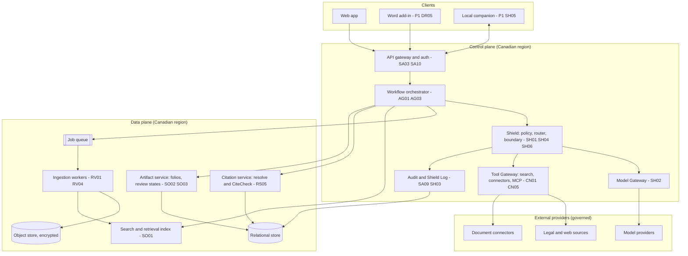
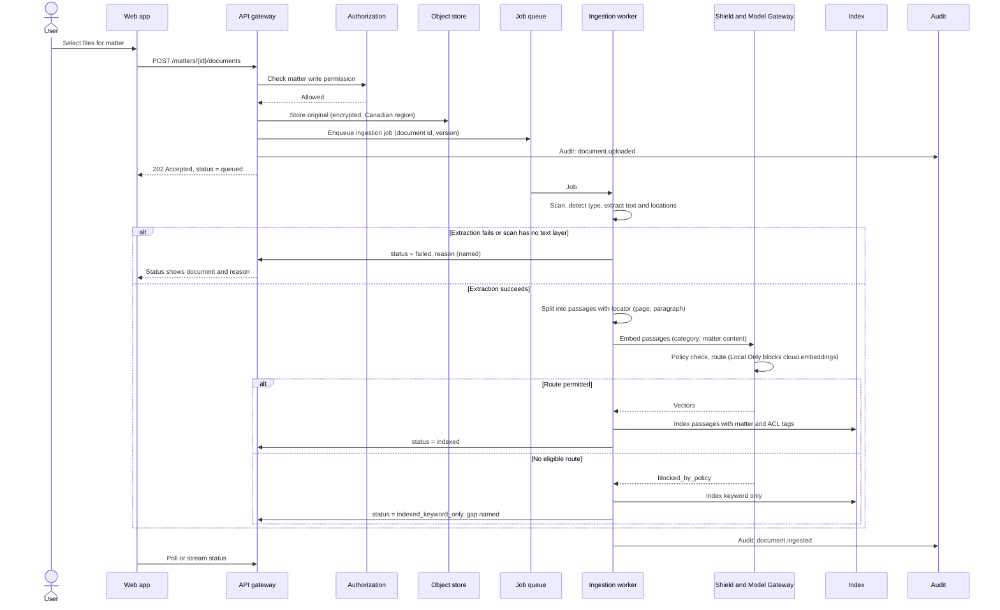
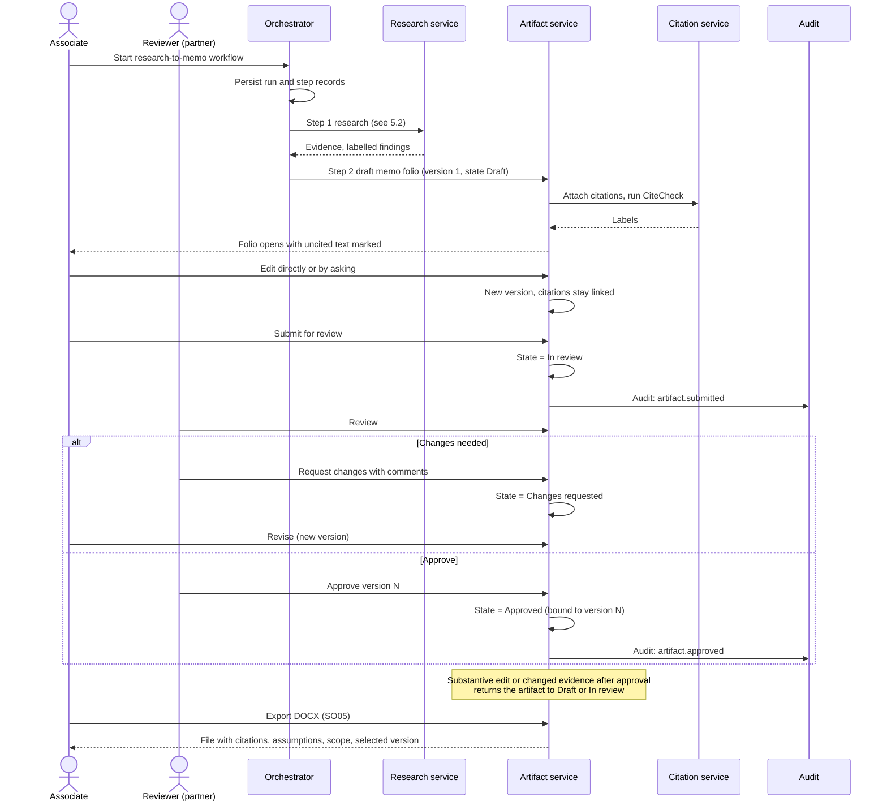
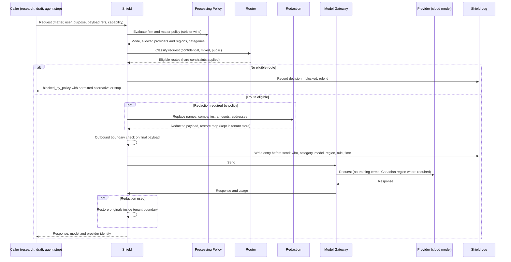

# System Architecture

> Requirements reconciliation — November 9, 2026. The [Workflow Contracts](../04-specs/Northwrit_Workflow-Contracts.md) govern review invalidation, export eligibility, lifecycle handoffs, and baseline release scope. Architectural approval does not establish implementation status.
## Components, flows and non-functional requirements

**Version:** 1.0 | **Date:** November 3, 2026 | **Status:** Proposed (nothing is built yet)

---

## 1. Purpose and scope

This document describes the proposed architecture of Northwrit, a privacy-first legal AI workspace for Canadian law firms and in-house teams. It implements the [Feature Specification](../04-specs/Northwrit_Feature-Spec.md); feature IDs (for example RS05, SH02) refer to that document. Related documents:

- [Hybrid AI Architecture](Northwrit_Hybrid-AI-Architecture.md): Shield, routing, outbound boundary
- [Data Model](Northwrit_Data-Model.md)
- [API Design](Northwrit_API-Design.md)
- [Security and Compliance](Northwrit_Security-Compliance.md)
- [Deployment Architecture](Northwrit_Deployment-Architecture.md)
- [Architecture Stack](Northwrit_Architecture-Stack.md)
- [Platform Layers & Surfaces](Northwrit_Platform-Layers-and-Surfaces.md): Cohere North private agentics × Harvey AI legal intelligence synthesis

Everything here is a proposal to be validated in the pilot. Where a choice is open, it is marked **Open**.

## 2. Architectural principles

| # | Principle | Source |
|---|---|---|
| 1 | The **matter** is the boundary for data, policy, audit and agent runs. | MT01, SA01 |
| 2 | Nothing calls a model, search provider or connector directly. Every call passes through the Model Gateway or the Tool Gateway, under the Processing Policy. | SH01, SH02 |
| 3 | Privacy and residency are hard constraints. Cost and latency optimise only among permitted routes. | SH06 |
| 4 | Retrieved content is untrusted. Model output cannot grant itself access. | Cross-cutting |
| 5 | A resolved citation is not a verified proposition. | RS05 |
| 6 | Failures are visible. No silent change of jurisdiction, source coverage, model location or scope. | Cross-cutting |
| 7 | A lawyer approves the exact payload before any external write. | AG03 |
| 8 | Logs record categories and identifiers, not duplicate sensitive payloads. | SH03, SA09 |

## 3. Logical architecture



## 4. Components

| Component | Responsibility | Features |
|---|---|---|
| **Web app** | Matter workspace, chat, evidence viewer, folio editor, admin screens. Shows matter, jurisdiction, processing mode and review status at all times. | MT01, MT03, SO02, AS01 |
| **API gateway and auth** | TLS termination, MFA, SSO, session and token validation, rate limits and budgets, request logging. | SA03, SA06, SA10 |
| **Authorization service** | Tenant and matter checks, roles, ethical walls. Called at ingestion, retrieval, tool use and artifact access, not only at the edge. | SA01, SA07, SA11 |
| **Workflow orchestrator** | Runs bounded workflows as persisted steps. Handles cancellation, resumable failures, checkpoints and idempotency keys. | AG01, AG02, AG03 |
| **Shield** | Processing Policy evaluation, Smart Routing, redaction and restore, outbound boundary checks, Shield Log. See [Hybrid AI Architecture](Northwrit_Hybrid-AI-Architecture.md). | SH01 to SH07 |
| **Model Gateway** | One internal interface over cloud models and local runtimes. Applies Shield decisions, records usage. | SH02, CN01, AS02 |
| **Tool Gateway** | Same control for web search, legal-source retrieval, connectors, MCP and Pack tools. These are data-exit paths. | CN01 to CN06 |
| **Ingestion workers** | Virus scan, type check, text extraction, OCR (P1), chunking into passages, embeddings (via gateway), per-document status. | RV01, RV02, RV04 |
| **Search and retrieval** | Hybrid keyword and semantic search with permission filters applied in the query, not after. | SO01, RS03 |
| **Research service** | Bearings, source filters, retrieval from permitted sources, synthesis labelled by source type. | RS01 to RS04 |
| **Citation service** | Resolves citations to a source and location, then runs the support check. Assigns Verified, Unverified, Contradicted or Unavailable. | RS05 |
| **Artifact service** | Folios, versions, comparisons, review states, DOCX export (PDF and Excel at P1). | SO02 to SO06, RS06 |
| **Audit service** | Append-only audit events, exportable (export at P1). | SA09 |
| **Admin and policy service** | Model Policy, retention, budgets, roles, feature toggles. | SA05, SA08, SA13 |
| **Evaluation harness (internal)** | Northwrit Bench runs on every change to models, retrieval, prompts, tools or policy. Release gate. | QA01 |
| **Local companion (P1)** | Local parsing, indexing, encrypted storage, optional local inference. See Deployment. | SH05 |

## 5. Key flows

### 5.1 Upload and ingestion (RV01, RV02, MT01, SA01)

Access controls on the matter exist before any content is ingested. A failure names the document and the reason.



### 5.2 Cited research with CiteCheck (RS01 to RS05)

```mermaid
sequenceDiagram
  actor U as User
  participant W as Web app
  participant R as Research service
  participant S as Shield
  participant T as Tool Gateway
  participant X as Index
  participant M as Model Gateway
  participant C as Citation service
  participant L as Shield Log and Audit

  U->>W: Ask legal question, choose source scope
  W->>R: Question, matter id
  R->>R: Bearings: jurisdiction, date, side, facts present?
  alt Missing items
    R-->>W: Ask user; do not assume
    U->>W: Provide items
  end
  R->>X: Retrieve matter passages (permission filtered)
  R->>S: Build outbound query (category: research query)
  S->>S: Policy and boundary check, redact if required
  alt Allowed
    S->>T: Search permitted sources
    T-->>R: Source passages with provenance
    S->>L: Shield Log entry
  else Blocked
    S-->>R: blocked_by_policy, offer local path or stop
  end
  R->>M: Synthesize with labelled evidence (retrieved text marked untrusted)
  M-->>R: Draft answer with claim-to-citation map
  R->>C: Resolve each citation
  C-->>R: Resolved, or Unavailable
  R->>C: Support check: does passage support claim?
  C->>M: Judge call (through gateway, same policy)
  M-->>C: Supports, contradicts or not shown
  C-->>R: Labels Verified, Unverified, Contradicted, Unavailable
  R-->>W: Answer, source panel, labels, coverage limits, unknowns
  R->>L: Audit: research.completed
```

CiteCheck never implies a citator (good-law) check. Authority treatment is a separate P2 capability (RS10) that depends on licensed data.

### 5.3 Memo draft, review and approve (AG01, RS06, SO02 to SO05, AG03)



Cancellation stops new side effects and keeps completed step records. A failed step can be resumed without repeating completed steps.

### 5.4 Cloud send through Shield (SH01 to SH04, SH06, SH07)



## 6. Failure behaviour

| Situation | Behaviour |
|---|---|
| Ingestion fails | Status names the document and the reason; other documents continue. |
| Source unavailable | Partial result; the gap is named; coverage limits shown (RS03). |
| Cloud route prohibited | Offer a permitted local route (when SH05 is available) or stop that step; never escalate silently. |
| Provider outage | Fall back only to a route that passes the same policy; otherwise the step fails visibly and is resumable. |
| Citation cannot be resolved | Marked Unavailable; blocks nothing, but is flagged in export. |
| Policy changed mid-run | In-flight steps re-evaluate before the next send; the run records which policy version applied. |

## 7. Non-functional requirements (proposed targets)

These are engineering targets to calibrate in the pilot; they are not observed results.

| Area | Requirement | Related |
|---|---|---|
| **Tenant and matter isolation** | Zero cross-matter or cross-tenant disclosures in adversarial tests across retrieval, artifacts, memory and connector results. | SA01, SA11 |
| **Data residency** | Customer content and operational data stored and processed in Canadian regions where the firm selects it. Provider region is checked per call. | SA02, SA12 |
| **Local Only isolation** | Zero unapproved network egress in supported Local Only workflows, verified at the process and network boundary. | SH05 |
| **Citation resolution** | 100% of exported citations resolve or are marked unavailable. | RS05 |
| **Claim support** | At least 95% of sampled material claims supported on a lawyer-reviewed set; zero fabricated authorities. | QA01 |
| **Operational completion** | At least 95% completion on supported test tasks, excluding reported source outages; no silent partial success. | AG01 |
| **Latency** | Record p50 and p95 for upload-to-indexed, first answer token, and memo completion; set targets after measuring representative workloads. | SA14 |
| **Availability** | Target and measurement window to be set with design partners; planned maintenance windows announced. | |
| **Recovery** | RPO and RTO to be set per tier; see [Deployment Architecture](Northwrit_Deployment-Architecture.md). | |
| **Scalability** | Horizontal scaling of workers and retrieval; per-tenant rate limits and task budgets prevent noisy neighbours. | SA06 |
| **Auditability** | Every model call, agent step and change is an audit event; export at P1. | SA09 |
| **Accessibility** | WCAG 2.1 AA for core screens. | Cross-cutting |
| **Language** | Canadian spelling; English at P0; French is an open decision. | CU01 |
| **Portability** | Matter export as JSON plus original files. | Cross-cutting |
| **Maintainability** | Every change to models, retrieval, prompts, tools or policy reruns Northwrit Bench. | QA01 |

## 8. Phasing

| Phase | Architecture delivered |
|---|---|
| **P0** | Cloud workspace in a Canadian region; ingestion; hybrid search; Answer Engine; CiteCheck; folios and review states; fixed research-to-memo workflow (AG01); Shield policy, gateway, Shield Log and outbound boundary; isolation, encryption, audit, MFA. |
| **P1** | Local companion with validated Local Only subset; Smart Routing; Redact and Restore; OCR and email; Review Grid; playbooks; Agent Studio; one connector; SSO and SCIM; ethical walls. |
| **P2** | Desktop and offline mode; connector directory; MCP and enterprise APIs; Pack governance; routing optimisation. |

## 9. Open items

1. API implementation language and framework (see [Architecture Stack](Northwrit_Architecture-Stack.md)).
2. Web search provider for the Answer Engine.
3. Whether local inference is required at pilot launch or at P1.
4. Launch jurisdiction (Ontario is the working assumption).
5. French-language support at launch.
