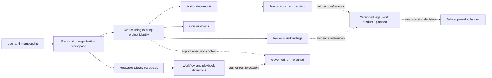

# Phase 2B — Architecture and domain principles

Prepared November 16, 2026 on planning baseline `83c6c91`. Status: source-backed architecture assessment and recommended principles. It is not an accepted Matter schema/API design, proof of isolation, or implementation of Phase 4. Phase 2A scope decisions and named owners/reviewers remain pending.

## Architecture position

Retain the existing TypeScript application and its domain boundaries. Web uses Next.js and the same-origin API gateway; the Express API owns domain behavior; API-owned workers run background work; Word and Electron retain their documented client boundaries. Reuse `packages/contracts`, `packages/client` and `packages/ui` without importing application internals into shared packages.

No new service, repository, framework, database technology or duplicate worker domain is proposed. Existing [ownership](../06-technical/NorthWrit-Repository-Ownership.md), [current architecture](../06-technical/NorthWrit-Current-Implementation.md), [backend rules](../engineering/backend-architecture.md) and ADRs remain authoritative. A future structural change requires a recorded decision and evidence of need.

## Source-backed baseline

| Domain | Existing implementation evidence | Boundary to preserve / open question |
| --- | --- | --- |
| Organization and workspace | [Schema](../../apps/api/schema.sql), [workspace context](../../apps/web/src/app/contexts/WorkspaceContext.tsx), [workspace checks](../../apps/api/src/lib/documentWorkspace.ts) | Personal and organization content are distinct placements; a firm workspace is not the legal client on a matter |
| Matter foundation | [Projects domain](../../apps/api/src/modules/projects/), schema `projects` | Existing ID, name, `cm_number`, practice, organization, visibility and archive fields are building blocks; legal client, jurisdiction/status/team semantics need 4A decisions |
| Item access | [Access](../../apps/api/src/lib/access.ts), [permissions](../../apps/api/src/lib/permissions.ts), [project grants](../../apps/api/src/lib/projectAccess.ts), [organization overrides](../../apps/api/src/lib/orgAccessOverrides.ts) | Item owner/editor/viewer capabilities differ from organization owner/admin/member roles; direct grants and organization access have different semantics |
| Documents and versions | [Document domain](../../apps/api/src/modules/documents/), schema `documents`/`document_versions`, [versions](../../apps/api/src/lib/documentVersions.ts) | Stable document identity and source versions; a document may belong to a matter, Library or workflow assets rather than always a matter |
| Upload/processing | [Uploads](../../apps/api/src/modules/uploads/), [jobs](../../apps/api/src/jobs/registry.ts) | Destination authorization, processing success and extracted text availability are distinct; transfer success does not imply readable evidence |
| Conversations and review | [Chat](../../apps/api/src/modules/chat/), [project chat](../../apps/api/src/modules/project-chat/), [tabular](../../apps/api/src/modules/tabular/) | Matter and standalone contexts both exist; preserve resource access and placement checks |
| Reusable definitions | [Workflows](../../apps/api/src/modules/workflows/), [playbooks](../../apps/api/src/modules/playbooks/), [Library](../../apps/api/src/modules/library/) | Reusable definitions/assets are not permission grants or proof of a complete governed agent product |
| Downloads and export | [Downloads](../../apps/api/src/modules/downloads/), [export orchestration](../../apps/api/src/application/exports/) | Access at request/finalization and issued storage capabilities differ; signature lifetime must be explicit |
| Execution | [Worker runtime](../../apps/api/src/workers/), [application jobs](../../apps/api/src/application/), [subagents](../engineering/subagents.md) | Streaming/in-memory runs, persistent jobs and future governed agent runs must not be treated as equivalent durability guarantees |
| Model/tool configuration | [Models](../../apps/api/src/modules/models/), [provider guides](../engineering/configured-models.md), [connectors](../engineering/connectors.md) | Provider availability, tool permission, model routing and action approval are separate decisions |

This review inspected schema definitions, project route/service composition and access/workspace helpers. It did not run database, provider or Office acceptance tests. The existing [product catalogue](../02-product/NorthWrit-Product-Catalogue.md) documents wider client/configuration limits.

## Recommended conceptual model

This diagram expresses ownership/context concepts, not new SQL tables or API endpoints. Dashed relationships are planned capabilities.

A legal client/party is a domain relationship, not an organization membership or sharing mechanism. Its representation, cardinality and any shared-client record lifecycle are 4A decisions. Existing standalone content remains valid; this model must not force legacy Library documents or independent reviews into a newly created matter.

## Principles for the implementation packages

### 1. Stable identity and compatible evolution

Use existing project IDs and `/projects` routes as the initial Matter identity. Display names and navigation do not rename physical tables or approve a new authorization model. Audit existing values before adding columns or introducing a client entity. Preserve legacy personal/direct-shared/organization resources and source notices. No historical migration is rewritten.

Detailed field types, nullability, client relationships, lifecycle transitions, indexes, wire contracts and migration/backfill strategy belong to 4A. Every schema change must update the fresh schema and migration ledger and pass fresh/upgrade tests before acceptance.

### 2. Explicit context and independently checked access

The selected workspace filters context; it does not grant access. Reading a source requires resource access and allowed placement in the current operation. Being able to read documents in two workspaces does not authorize mixing them into one answer.

Current project access includes organization membership/defaults and resource overrides, while direct grants use normalized email identities. The creator/provenance field is not a universal authorization rule. Do not replace these paths with a single `user_id` comparison or convert organization roles directly into item rights.

Organization-owner access to private content and any selected ethical-wall deny precedence must be resolved against current semantics. Do not promise that private content is invisible to all administrators or silently remove existing owners' access. Any changed policy needs an explicit compatible implementation and negative tests.

Workflow assets are intentionally handled differently by the current workspace helper and reached through workflow rules. Audit both workflow authorization and asset use; do not assume the ordinary document-placement helper covers every asset path. Cross-matter reuse within an allowed workspace also needs an explicit selected-source/operation rule, not merely workspace equality.

### 3. Evidence identity is independent of the active source

A finding references the exact authorized document version and source passage used. Changing the active document cannot silently redirect old evidence to new text. Missing text, incomplete OCR, deleted/unavailable evidence and replacement failures remain visible. Memory/preferences are neither source authority nor permission grants.

Phase 4 establishes context and version continuity. Phase 5 supplies the stronger stale-evidence, legal citation and output-approval contracts. A hash or export signature establishes its defined integrity property, not legal correctness or lawyer approval.

### 4. Reusable definition, execution and approval are separate records

Keep workflow/playbook definitions under their existing domains. An invocation should have one execution identity/history regardless of whether opened from Workflows, Agents or a matter. The future governed-run contract needs explicit actor/workspace/matter/resource scope and versioned inputs; this does not claim that a complete run registry already exists.

Folio approval concerns a work-product version and its evidence. Agent action approval concerns a plan/tool/payload. Neither substitutes for the other. Use the [approved navigation ownership](../05-design/NorthWrit-Feature-Navigation.md#navigation-ownership-and-scope) rather than duplicate stores behind tabs.

### 5. Check authorization when work actually happens

API admission alone is insufficient for queued jobs, export finalization and later application download redemption. Recheck current authority at execution/publication boundaries; define cancellation, retry, idempotency and owner-offboarding behavior. Record a safe terminal state if authority is revoked.

An issued storage URL may remain usable for its configured capability lifetime without another membership check. Decide whether the selected security requirement needs shorter lifetimes, application-mediated delivery or another revocation mechanism. Do not claim immediate revocation of all issued storage signatures without an implementation that provides it.

### 6. Place responsibilities in existing owners

- Routes parse requests, apply request middleware, invoke service facades and map results; domain code owns reusable authorization/business decisions.
- Domain services do not depend on Express request objects. Cross-domain account/export/purge/job flows live in `apps/api/src/application/`.
- Shared kernel/middleware does not depend on domain implementations. Worker entry points compose API-owned jobs rather than copying them into another app.
- Serialized producer/consumer contracts belong in `packages/contracts`; framework-free client behavior in `packages/client`; shared primitives in `packages/ui`.
- Legal client/domain concepts do not justify a new service or repository. Use measured ownership/runtime needs and an ADR before extraction.

### 7. Make AI/client constraints explicit

An available model does not authorize every data route or connector action. Current configurable direct-write behavior is not acceptance of the planned stronger Shield/Folio controls. Keep provider/source rights, actual deployment region and approval policy as explicit dependencies. No keys, signed URLs or authenticated browser state belong in planning artifacts.

The demo model remains unconfigured and live AI verification deferred. Word currently has separate conversation/history and Personal-context limits; Electron wraps the shared web surface but native package/release acceptance is separate. A web architecture decision must not imply cross-client parity.

## Phase 2B decision register

These are recommendations/open decisions, not accepted schema contracts.

| Ref | Recommendation / decision | State | Resolution gate and responsible role |
| --- | --- | --- | --- |
| B01 | Reuse current applications, domain facades and shared packages | Existing architectural authority; preserve | Domain/repository engineering; ADR before any structural change |
| B02 | Retain project identity and existing routes for initial Matters | Recommended compatibility default | 4A domain/API review of selected metadata changes |
| B03 | Define legal client, matter status/jurisdiction/team and archive semantics | Open; existing fields are not the full model | Product/domain review in 4A; no new migration in 2B |
| B04 | Preserve direct-sharing and organization access paths; define any wall/owner override changes | Current behavior plus open target-policy decision | Access/security review before affected 4A design and 4B exposure |
| B05 | Specify Library/workflow-source reuse across matter and workspace boundaries | Open operation-level contract | 4A/4C source-selection design; positive/negative fixtures |
| B06 | Bind evidence/work product to exact source/output versions | Recommended; foundational version data exists | Phase 4 continuity and Phase 5 legal/approval acceptance |
| B07 | Use one governed-run history with independent action/output approvals | Target contract; not implemented | Phase 5 approval and Phase 6 execution packages |
| B08 | Define signed-download lifetime and revocation promises | Open target-security decision | Before download/export acceptance in Phase 4 |
| B09 | Confirm provider routes, Canadian source/deployment claims and selected client profile | Pending 2A/2C decisions and configuration | Before dependent AI, real-data or client acceptance |
| B10 | Assign named owners/reviewers, effort and integration/migration test environment | Pending | Before each implementation increment |

## Inputs to Phase 4A

Prepare a schema/API/UI proposal only after the relevant 2A/2B decisions are resolved for that increment. Include the existing-field inventory, selected requirement IDs, proposed additions versus reuse, data migration/rollback, compatibility examples, authorization matrix, fixture cases and evidence/version implications. Do not infer a new client table, matter status enum or API alias merely from this conceptual model.

## Verification and closure

The document's local paths and links are checked; repository, branding and whitespace checks must pass before handoff. Source inspection does not establish database isolation, signed-link revocation, legal quality or actual runtime recovery. Phase 2B remains in review while the open register items and named reviewer decisions are unresolved. No application code, migration, credential, deployment or Phase 4 feature was changed by this assessment.
