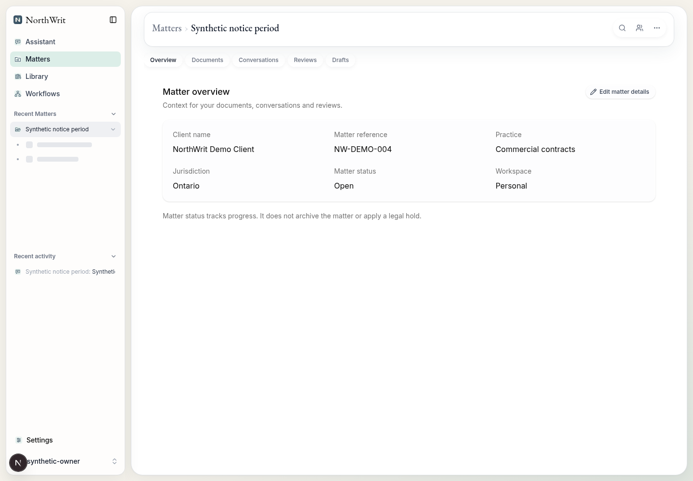
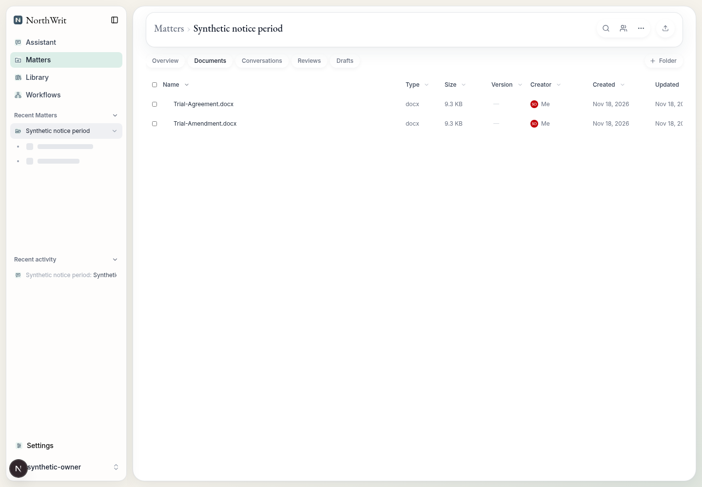
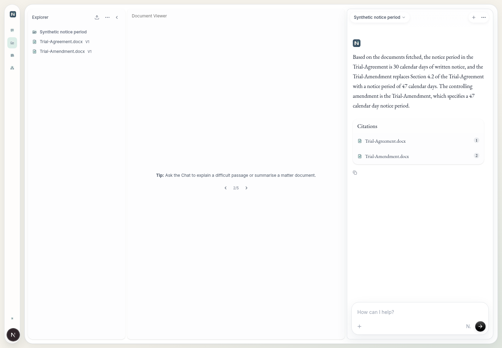
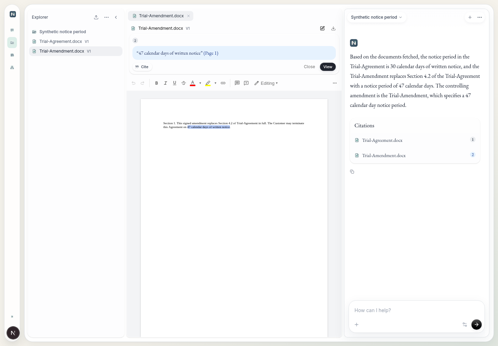
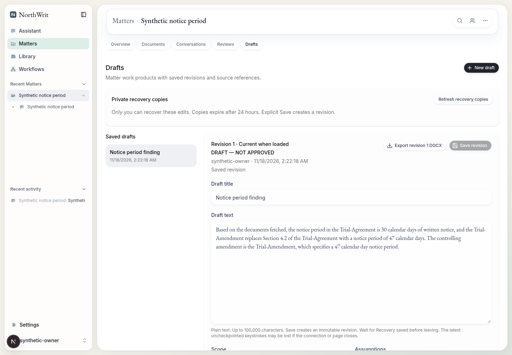
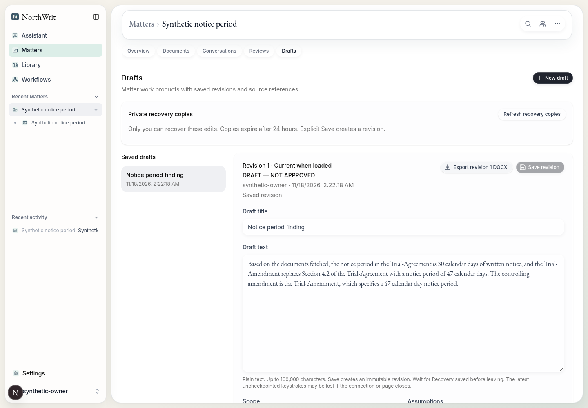
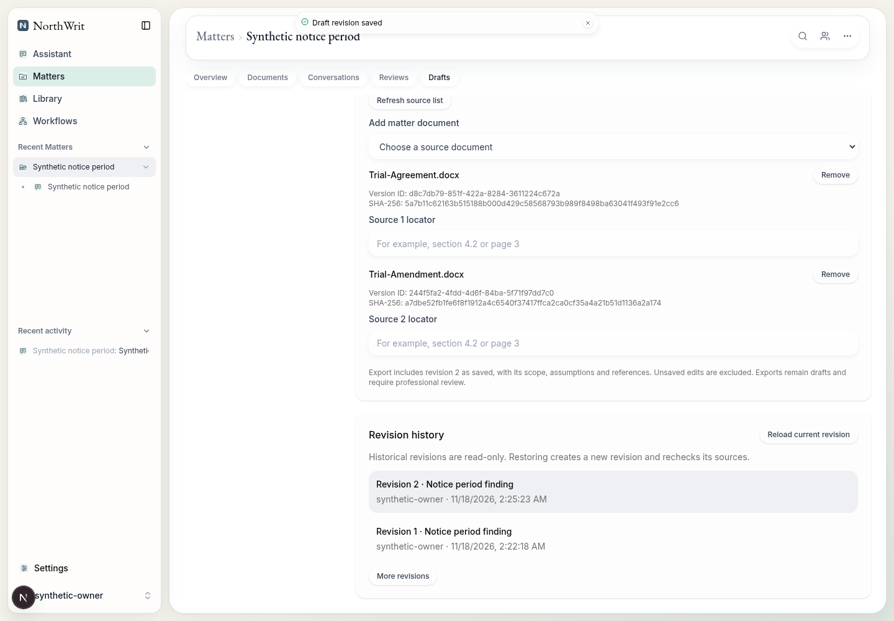

# Phase 4 workflow captures

Captured from the NorthWrit browser with synthetic documents and accounts. The conversation replays the previously verified live Ollama answer into disposable persisted fixtures. Source and version identifiers are rebound to matching synthetic documents. These screenshots show browser behavior, and the live inference evidence is recorded separately.

## Matter Overview

Synthetic client, matter reference, practice and jurisdiction.

## Matter Documents

Agreement and amendment processed in the matter.

## AI answer and citations

Previously verified Ollama answer displayed in a persisted conversation.

## Inspect the cited amendment

The selected quote and source document are visible together.

## Saved AI draft

The recorded answer saved with its exact source references.

## DOCX export

The selected saved revision was downloaded and its DOCX XML checked.

## Revision history

A second revision adds an explicit manual reviewer note.

