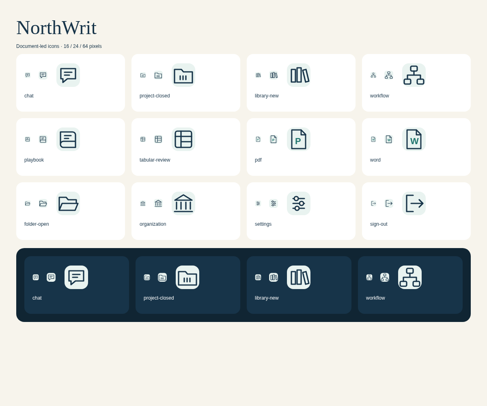

# NorthWrit visual identity

NorthWrit's mark uses a continuous N with a folded upper-right corner: writing, connected context and a clear forward direction. The icon family uses simple document, conversation and workflow forms rather than detailed miniature objects.

## Assets and ownership

- Canonical app mark: `apps/web/src/app/icon.svg`.
- Shared animated/status mark: `packages/ui/src/NorthWritIconUI.tsx`. Its existing tint, error, completion and theme subscriptions are retained.
- Wordmark: `apps/web/public/icons/northwrit-logo.svg`.
- Feature, file, folder and legal-source SVGs: `apps/web/public/icons/`.
- Distribution rasters: web favicon/Apple touch icon, Word 16/32/80 icons and desktop PNG/ICNS.
- Social cards: `apps/web/public/northwrit-social.jpg` and compatibility asset `link-image.jpg`.
- Original AI-generated editorial illustration: `docs/assets/brand/northwrit-paper-illustration.png`. This is artwork, not an application screenshot or evidence of an AI product run.

The palette uses midnight navy `#173449`, deep teal `#22766F`, ivory `#F7F4EC` and a sea-glass accent `#64B5A6`. On dark surfaces, transparent feature icons need a pale backing; the feature family includes its own pale plate. Shared mark theme/status variants continue to supply their existing contrasting backgrounds.

Provider/integration marks retain their third-party identities. Existing licenses, credit records and legal notices remain authoritative. Product screenshots show real application views and must be recaptured after visual changes rather than edited to simulate the result.

## Reproduction

Run `node scripts/generate-brand-assets.mjs` from the repository root with the existing browser-test dependencies installed. Set `CHROMIUM_PATH` when Chromium is not at `/usr/bin/chromium`. This renders the authored SVG into all platform sizes, favicon ICO, PNG-backed ICNS and social cards without a new dependency or native macOS packaging step. Native installation, signing and OS cache refresh are separate release checks.

The desktop `assets/icon.html` is a matching preview source; regenerate platform outputs with the root script after changing the canonical SVG. Keep the shared React geometry and wordmark synchronized with that SVG.

## Preview

## Verification

November 16, 2026: 59 affected icon/sidebar tests passed. Web production build and lint passed (zero lint errors, 29 existing warnings). Word app/e2e type checking and production build passed using the CI placeholder origins; the Word bundle retained three size/performance warnings. Product SVG XML, favicon offsets/PNG entries and seven desktop ICNS representations validated. Web/mobile navigation and small/large icons on light/dark surfaces were visually inspected; the real Electron demo was recaptured. Native macOS installation/signing and an actual Word host were not exercised. AI execution remains pending model configuration.
